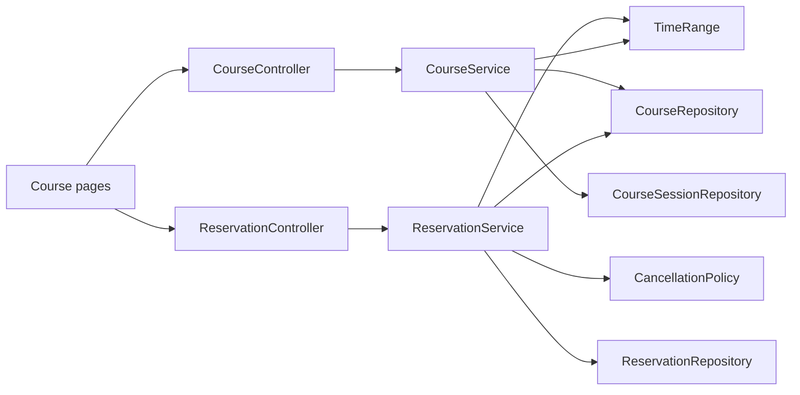
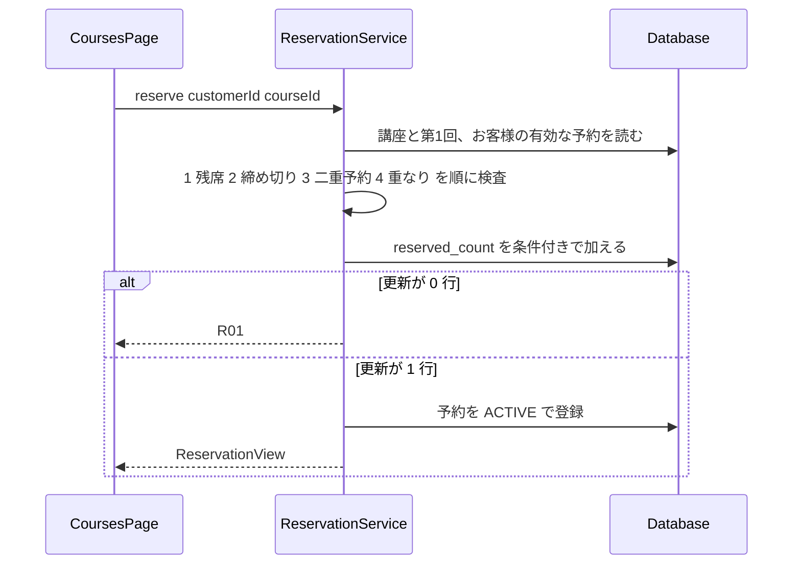
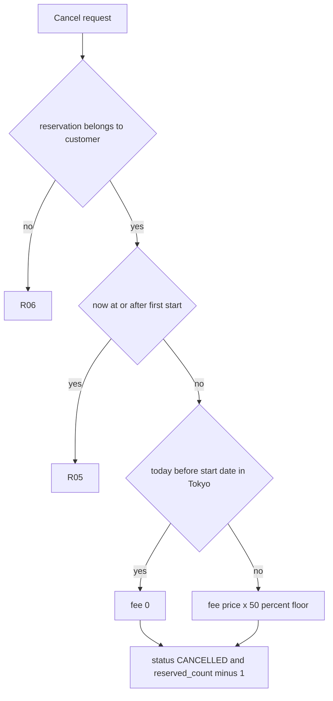
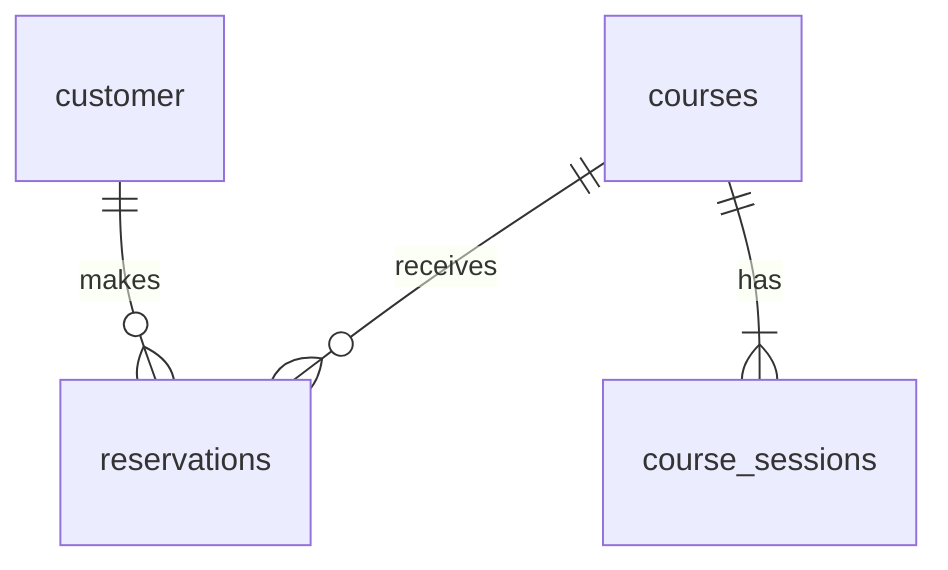

# Design Document

## Overview

**Purpose**: 店が開く講座（単発・連続）の席を、お客様が予約しキャンセルできるようにする。店の担当者は講座とその各回を登録する。
**Users**: お客様が講座一覧から予約し、予約一覧からキャンセルする。店の担当者が講座を登録する。
**Impact**: EC と同じプロジェクトに、講座・講座の回・予約の 3 つのテーブルと `reservation` パッケージを足す。共通部分は、例外の受け口・テストのデータ初期化・画面の入口の 3 つだけを変える。

### Goals
- 予約の受付条件（R01 から R04）を要件 3.1 の順に検査し、最初に満たさなかった検査のエラーを返す
- 有効な予約の件数が、同時に予約されても定員を超えない
- キャンセル料の算出を `CancellationPolicy` の 1 か所に集め、受入基準の金額と 1 円の違いもなく一致させる
- 講座の登録の検査（R07 から R09）を要件 8.1 の順に行い、エラーなら何も登録しない

### Non-Goals
- 受講料とキャンセル料の決済・返金、材料費、登録済みの講座の変更と削除、連続講座の途中の回だけの予約とキャンセル、講座の検索と絞り込み（requirements.md の Out of scope）
- 連続講座の途中の回の欠席の記録（要件 7 は「何もしない」ことを定める。欠席のデータも画面も作らない）
- 同じお客様が別々の講座を同時に予約したときの時間帯の重なり、同時の講座登録での教室と講師の重なり（要件に同時実行の定めがない）

## Boundary Commitments

### This Spec Owns
- 講座・講座の回・予約のテーブルと、残席（`reserved_count`）の整合
- 予約の受付条件、席の確保、キャンセルとキャンセル料、講座の登録の検査
- エラーコード R01 から R09 と、その HTTP 応答
- 講座一覧・予約一覧の表示内容（残席の文言、予約ボタンとキャンセルの可否、現在のキャンセル料）を返す API
- 講座一覧・予約一覧・講座登録の 3 つの画面

### Out of Boundary
- ログインとお客様の管理（EC の既存の仕組み）
- 決済、返金、材料費、担当者の権限の判定、登録済みの講座の変更と削除
- ほかの業務（EC・購買申請・定期便）のクラスとテーブル

### Allowed Dependencies
- 既存の `customer` テーブル。お客様は ID だけで扱い、EC のクラスは参照しない（steering の structure.md）
- 既存の `Clock` の Bean（`config/ClockConfig`）と `ApiExceptionHandler`
- Spring Boot 4.1（Web MVC・Data JPA・Validation）、PostgreSQL 18、Flyway。新しいライブラリは足さない

### Revalidation Triggers
- `ReservationError` のコードとメッセージの変更（画面とテストが依存する）
- 受付の締め切り（開始の 1 時間前）、キャンセル料の率（50 %）、日付の区切りの変更
- `reserved_count` の更新方法の変更（同時予約のテストが依存する）
- 材料費、担当者の権限、再キャンセルのエラーが決まったとき（requirements.md の追記と、本書の「未決定の事項と設計の扱い」の見直し）

## Architecture

### Existing Architecture Analysis
- 業務ごとのパッケージを `controller・service・repository・entity・dto・exception` に分ける（billing・approval と同じ）。controller は repository を呼ばない
- 例外は `XxxException(XxxError)`。`ApiExceptionHandler` が `code`（enum の name）と `message` を JSON で返す
- 現在日時は `Clock` の Bean から取る。テストは `MutableClock` に差し替える

### Architecture Pattern & Boundary Map



- 依存の向きは `controller → service → repository → entity`。`CancellationPolicy` と `TimeRange` はデータベースに触らない純粋な計算で、service だけが呼ぶ
- `ReservationService` は `CourseRepository` を使う（同じ `reservation` パッケージ内の依存）。`CourseService` と `ReservationService` は互いのクラスを呼ばない
- Selected pattern は billing と同じ層構成。新しい境界は作らない

### Technology Stack

| Layer | Choice / Version | Role in Feature | Notes |
|-------|------------------|-----------------|-------|
| Frontend | React 19・React Router 7・axios | 講座一覧・予約一覧・講座登録の画面 | 業務ルールは持たない |
| Backend | Spring Boot 4.1（Web MVC・Data JPA） | API と業務ルール | 追加のライブラリはない |
| Data | PostgreSQL 18・Flyway | 講座・回・予約 | V2 でテーブルを作る |

## File Structure Plan

### Directory Structure
```
backend/src/main/java/com/example/ecsite/reservation/
├── controller/
│   ├── CourseController.java        # GET /api/reservation/courses、POST /api/reservation/courses
│   └── ReservationController.java   # 予約・一覧・キャンセルの API
├── service/
│   ├── CourseService.java           # 講座一覧の組み立て、講座の登録と入力検査（R07 から R09）
│   ├── ReservationService.java      # 予約の受付条件と席の確保、予約一覧、キャンセル
│   ├── CancellationPolicy.java      # キャンセルの可否とキャンセル料の算出（純粋な計算）
│   └── TimeRange.java               # 開始・終了の組と、重なりの判定（接するだけなら重ならない）
├── repository/
│   ├── CourseRepository.java        # 講座の取得、reserved_count の条件付き増減
│   ├── CourseSessionRepository.java # 教室・講師が重なる回の検索
│   └── ReservationRepository.java   # 予約の取得、有効な予約の絞り込み、キャンセルの条件付き更新
├── entity/
│   ├── Course.java                  # 講座（sessions を持つ）
│   ├── CourseSession.java           # 回
│   ├── CourseKind.java              # SINGLE / SERIES
│   ├── Reservation.java             # 予約
│   └── ReservationStatus.java       # ACTIVE / CANCELLED
├── dto/
│   ├── CourseView.java              # 講座一覧の 1 行
│   ├── SessionView.java             # 回の表示
│   ├── CourseRequest.java           # 講座登録の入力（回の入力を含む）
│   ├── ReservationView.java         # 予約一覧の 1 行
│   └── CancelResult.java            # キャンセルの結果
└── exception/
    ├── ReservationError.java        # R01 から R09
    └── ReservationException.java

backend/src/main/resources/db/migration/V2__create_reservation_tables.sql   # 3 テーブルと制約
backend/src/main/resources/db/sample/R__sample_courses.sql                  # 動作確認用の講座

backend/src/test/java/com/example/ecsite/reservation/
├── ReservationTestBase.java         # 固定した Clock、データの準備
├── CourseApiTest.java               # 講座一覧（要件 2）
├── ReservationReserveTest.java      # 受付条件と席の確保（要件 3・4）
├── ReservationOverlapTest.java      # 時間帯の重なり（要件 3 の 6 から 9）
├── ReservationCancelTest.java       # 予約一覧とキャンセル料（要件 5・6）
├── CancellationPolicyTest.java      # 日付と金額の境界（要件 5・6）
├── CourseRegistrationTest.java      # 講座の登録（要件 8）
└── ReservationConcurrencyTest.java  # 同時予約（要件 4 の 3）

frontend/src/pages/
├── CoursesPage.tsx                  # 講座一覧と予約ボタン（担当者向けの登録画面へのリンクを含む）
├── MyReservationsPage.tsx           # 予約一覧とキャンセル
└── CourseRegisterPage.tsx           # 講座の登録フォーム
```

### Modified Files
- `backend/src/main/java/com/example/ecsite/exception/ApiExceptionHandler.java` - `ReservationException` の `@ExceptionHandler` を足す
- `backend/src/test/java/com/example/ecsite/TestDataHelper.java` - `reset()` の TRUNCATE に `reservations, course_sessions, courses` を足す
- `frontend/src/App.tsx` - `/courses`・`/reservations`・`/courses/new` のルートを足す
- `frontend/src/components/Header.tsx` - 「講座」「予約一覧」のリンクを足す

## System Flows

### 予約の受付



- 検査は読み取りで順に行い、最初に満たさなかったものを返す。席の確保は最後の条件付き UPDATE が決める。同時に定員を超えた予約は R01 になる
- エラーはすべてトランザクションをロールバックし、予約の件数と `reserved_count` を変えない（4.4）
- 部分一意索引に違反した場合（同じお客様の同じ講座を同時に 2 回予約）は、R03 として返す

### キャンセル



- 本人の確認（R06）を先に行い、そのあとで開始時刻を確かめる（R05）。他人の予約の開始後でも R06 を返す
- キャンセルは `UPDATE reservations SET status = 'CANCELLED' ... WHERE id = ? AND status = 'ACTIVE'` で行う。更新が 0 行のときは 0 円で終えず、未決定の事項（再キャンセル）に当たるため、本書では扱いを決めない（下の表）

## Requirements Traceability

| Requirement | Summary | Components | Interfaces | Flows |
|-------------|---------|------------|------------|-------|
| 1.1, 1.2 | 講座と回の保持 | Course, CourseSession, V2 | テーブル courses / course_sessions | - |
| 1.3 | 単発は 1 回 | CourseService（登録時）、CourseRequest | POST courses | 未決定の事項の表 |
| 2.1 | 一覧の表示項目 | CourseService, CourseView | GET courses | - |
| 2.2, 2.3 | 残席の文言 | CourseService（seatLabel） | CourseView.seatLabel | - |
| 2.4, 2.5 | 予約ボタンの状態 | CourseService（reservable） | CourseView.reservable | - |
| 3.1 | 検査の順序 | ReservationService | POST reservations | 予約の受付 |
| 3.2 から 3.6 | R01 から R04、境界 | ReservationService, TimeRange | ReservationError | 予約の受付 |
| 3.7, 3.8 | 全回で判定、接するだけは重ならない | TimeRange | - | 予約の受付 |
| 3.9 | キャンセル済みを除く | ReservationRepository（有効な予約だけ） | - | 予約の受付 |
| 4.1, 4.2 | 1 件の予約で全回の席 | ReservationService, CourseRepository | reserved_count の増加 | 予約の受付 |
| 4.3 | 同時予約で定員を超えない | CourseRepository（条件付き UPDATE） | CHECK 制約 | 予約の受付 |
| 4.4 | エラー時に変えない | ReservationService（@Transactional） | - | 予約の受付 |
| 4.5 | 再予約 | ReservationService, 部分一意索引 | - | 予約の受付 |
| 5.1 | 本人の有効な予約だけ | ReservationService, ReservationRepository | GET reservations | - |
| 5.2 から 5.4 | 現在のキャンセル料 | CancellationPolicy | ReservationView.cancelFee | キャンセル |
| 5.5 | 開始後は不可の表示 | CancellationPolicy | ReservationView.cancellable | キャンセル |
| 6.1 | キャンセル済みにして残席を戻す | ReservationService, CourseRepository | POST cancel | キャンセル |
| 6.2 から 6.4 | 日本時間の日付、0 円と 50 % | CancellationPolicy | - | キャンセル |
| 6.5, 6.6 | R05, R06 | ReservationService | ReservationError | キャンセル |
| 6.7 | 全回分の受講料が基準 | CancellationPolicy（講座の受講料をそのまま使う） | - | キャンセル |
| 6.8 | 受講料だけで計算 | CancellationPolicy | - | 未決定の事項の表 |
| 7.1, 7.2, 7.3 | 途中の回の欠席 | 該当する実装を置かない（予約の状態を変える処理と返金の処理を作らない） | - | - |
| 8.1 から 8.5 | 登録の検査と R07 から R09 | CourseService, CourseSessionRepository, TimeRange | POST courses | - |
| 8.6 | 接するだけは重ならない | TimeRange | - | - |
| 8.7 | エラー時は何も登録しない | CourseService（@Transactional） | - | - |
| 9.1 | コードとメッセージ | ReservationError, ApiExceptionHandler | ReservationError | - |
| 9.2 | 日本時間 | Clock の Bean, CancellationPolicy | - | - |

## Components and Interfaces

| Component | Domain/Layer | Intent | Req Coverage | Key Dependencies (P0/P1) | Contracts |
|-----------|--------------|--------|--------------|--------------------------|-----------|
| CourseController | controller | 講座の一覧と登録の HTTP 入出力 | 2, 8 | CourseService (P0) | API |
| ReservationController | controller | 予約・一覧・キャンセルの HTTP 入出力 | 3, 4, 5, 6 | ReservationService (P0) | API |
| CourseService | service | 一覧の組み立てと講座の登録 | 1, 2, 8 | CourseRepository (P0), CourseSessionRepository (P0), TimeRange (P0), Clock (P0) | Service |
| ReservationService | service | 受付条件、席の確保、一覧、キャンセル | 3, 4, 5, 6 | CourseRepository (P0), ReservationRepository (P0), CancellationPolicy (P0), TimeRange (P0), Clock (P0) | Service |
| CancellationPolicy | service | キャンセルの可否と料金 | 5, 6 | なし | Service |
| TimeRange | service | 時間帯の重なりの判定 | 3, 8 | なし | Service |
| ReservationError | exception | R01 から R09 | 9 | HttpStatus (P0) | State |
| 画面 3 つ | frontend | 表示と操作の入口 | 2, 5, 6, 8 | axios (P0) | - |

### service

#### ReservationService

| Field | Detail |
|-------|--------|
| Intent | 予約の受付条件の検査、席の確保、予約一覧、キャンセル |
| Requirements | 3.1 から 3.9, 4.1 から 4.5, 5.1, 6.1, 6.5, 6.6 |

**Responsibilities & Constraints**
- `reserve` と `cancel` は 1 つのトランザクションで、読み取りから更新までを行う
- 検査の順序は 残席 → 締め切り → 二重予約 → 重なり。この順序を変えない
- 重なりの判定は、お客様の有効な予約の講座の全回と、予約しようとする講座の全回を総当たりで比べる（3.7）
- お客様の識別は引数の `customerId` だけを使う（認証は Out of Boundary）

**Contracts**: Service [x] / API [x] / State [x]

##### Service Interface
```java
public interface ReservationOperations {
    ReservationView reserve(long customerId, long courseId);     // R01 から R04、存在しない講座は後述
    List<ReservationView> list(long customerId);                 // 有効な予約だけ
    CancelResult cancel(long customerId, long reservationId);    // R05, R06
}
```
- Preconditions: `customerId` は既存のお客様の ID
- Postconditions（reserve）: 予約が `ACTIVE` で 1 件増え、`reserved_count` が 1 増える
- Postconditions（cancel）: 予約が `CANCELLED` になり、`reserved_count` が 1 減る。`cancelFee` が予約に記録される
- Invariants: `reserved_count` は、その講座の `ACTIVE` な予約の件数と等しい

実装のクラス名は `ReservationService` とし、上のインターフェースは契約の記述であって、別のインターフェースを作らない。

##### API Contract
| Method | Endpoint | Request | Response | Errors |
|--------|----------|---------|----------|--------|
| POST | /api/reservation/reservations | `{ customerId, courseId }` | 201 ReservationView | R01 409, R02 409, R03 409, R04 409 |
| GET | /api/reservation/reservations?customerId= | - | 200 ReservationView[] | - |
| POST | /api/reservation/reservations/{id}/cancel | `{ customerId }` | 200 CancelResult | R05 409, R06 404 |

##### State Management
- 予約の状態は `ACTIVE → CANCELLED` の一方向。`CANCELLED` から `ACTIVE` には戻さず、再予約は新しい予約として登録する（4.5）
- 同時実行は `CourseRepository.tryAcquireSeat(courseId)`（条件付き UPDATE、更新行数を返す）で守る。`CancellationPolicy` の結果は予約を更新するときに保存する

**Implementation Notes**
- Integration: 部分一意索引の違反（`DataIntegrityViolationException`）は R03 に変換する
- Validation: 存在しない講座 ID は、要件にエラーがないため、設計では扱いを決めない（下の表）
- Risks: 件数の二重保存。同時予約のテストで `reserved_count` と予約の件数の一致を確かめる

#### CancellationPolicy

| Field | Detail |
|-------|--------|
| Intent | 現在日時と第 1 回の開始日時と受講料から、キャンセルの可否と料金を求める |
| Requirements | 5.2 から 5.5, 6.2 から 6.5, 6.7, 6.8, 9.2 |

```java
public record CancelDecision(boolean cancellable, long fee) {}

public final class CancellationPolicy {
    /** now は Clock から取った日本時間の現在日時。firstStart は第1回の開始日時。 */
    public CancelDecision decide(OffsetDateTime now, OffsetDateTime firstStart, long price);
}
```
- now が firstStart 以降（ちょうどを含む）なら `cancellable = false`（R05）
- それ以外で、日本時間の日付が開始日より前なら料金 0 円、同じ日なら `price * 50 / 100`（long の整数除算で 1 円未満を切り捨てる）
- `price` は講座の受講料そのもの。連続講座でも回数を掛けない（受講料が全回分を表す。6.7）。材料費は入れない（6.8）

#### TimeRange

```java
public record TimeRange(OffsetDateTime start, OffsetDateTime end) {
    public boolean overlaps(TimeRange other);  // this.start < other.end && other.start < this.end
}
```
- 一方の終了と他方の開始が同じなら重ならない（3.8, 8.6）。予約の重なりと、教室・講師の重なりの両方で、この 1 つの判定を使う

#### CourseService

| Field | Detail |
|-------|--------|
| Intent | 講座一覧の組み立てと、講座の登録 |
| Requirements | 1.1 から 1.3, 2.1 から 2.5, 8.1 から 8.7 |

```java
List<CourseView> list();                         // 開始日時の順
CourseView register(CourseRequest request);      // R07, R08, R09
```
- 一覧の `remaining` は `capacity - reserved_count`。`seatLabel` は 1 以上なら「残り n 席」、0 なら「満席」（2.2, 2.3）
- `reservable` は 残席が 1 以上、かつ 現在日時が 第 1 回の開始日時の 1 時間前以前（2.4, 2.5）。予約の受付の判定（3.1 の 1・2）と同じ条件を `ReservationService` と共有せず、`Course` の `isOpenFor(now)` に置いて両方が使う
- 登録の検査は 8.1 の順。1 開始が終了より前 → 2 定員が 1 以上 → 3 教室の重なり → 4 講師の重なり。教室と講師の重なりは、登録済みの回（`CourseSessionRepository`）と、同じ登録内の他の回の両方と比べる
- 講座・回の保存は 1 つのトランザクション。エラーなら何も残らない（8.7）

##### API Contract
| Method | Endpoint | Request | Response | Errors |
|--------|----------|---------|----------|--------|
| GET | /api/reservation/courses | - | 200 CourseView[] | - |
| POST | /api/reservation/courses | CourseRequest | 201 CourseView | R07 400, R08 409, R09 409 |

#### ReservationError

| 定数 | メッセージ | HTTP |
|------|-----------|------|
| R01 | 満席です | 409 |
| R02 | 受付を締め切りました | 409 |
| R03 | すでに予約しています | 409 |
| R04 | 時間帯が重なります | 409 |
| R05 | 開始後はキャンセルできません | 409 |
| R06 | 予約が見つかりません | 404 |
| R07 | 入力が正しくありません | 400 |
| R08 | 教室が重なります | 409 |
| R09 | 講師が重なります | 409 |

`ApiExceptionHandler` は `code = R01` などと `message` を返す。

### dto（契約の形）

```java
public record SessionView(OffsetDateTime startsAt, OffsetDateTime endsAt, String room, String instructor) {}

public record CourseView(long id, String name, String category, CourseKind kind, List<SessionView> sessions,
                         long price, int remaining, String seatLabel, boolean reservable) {}

public record CourseRequest(String name, String category, CourseKind kind, long price, int capacity,
                            List<SessionView> sessions) {}

public record ReservationView(long id, long courseId, String courseName, List<SessionView> sessions,
                              long price, long cancelFee, boolean cancellable) {}

public record CancelResult(long reservationId, long cancelFee) {}
```
- 日時は日本時間のオフセット付き（+09:00）で返す。`spring.jackson.time-zone=Asia/Tokyo` による
- `ReservationView.cancelFee` は、`cancellable` が false のときは 0 とし、画面は `cancellable` を見て「キャンセルできません」を表示する（5.5）

### frontend

- `CoursesPage` は `GET courses` を表示し、`reservable` が false のとき予約ボタンを無効にする。予約のエラーは `message` を表示する
- `MyReservationsPage` は `GET reservations` を表示し、`cancellable` が false のときキャンセルボタンの代わりに「開始後はキャンセルできません」を出す。キャンセルの前に `cancelFee` を確認の文言に入れる
- `CourseRegisterPage` は回の行を足せる入力フォームで、エラーの `code` と `message` を表示する。入力の検査は画面でしない

## Data Models

### Domain Model
- `Course` が集約の根で、`CourseSession`（回）を持つ。`Reservation` は `Course` を参照し、お客様は `customer_id` だけで持つ
- 不変条件は 3 つ。(1) 講座には 1 回以上の回がある (2) `reserved_count` は `ACTIVE` な予約の件数と等しい (3) 同じお客様の同じ講座の `ACTIVE` な予約は 1 件まで

### Physical Data Model（V2__create_reservation_tables.sql）



| Table | 列 | 制約 |
|-------|-----|------|
| courses | id BIGSERIAL PK, name VARCHAR(100), category VARCHAR(50), kind VARCHAR(10), price BIGINT, capacity INT, reserved_count INT DEFAULT 0 | kind IN ('SINGLE','SERIES')、capacity >= 1、reserved_count BETWEEN 0 AND capacity。price に範囲の制約は付けない（未決定） |
| course_sessions | id BIGSERIAL PK, course_id FK ON DELETE CASCADE, session_no INT, starts_at TIMESTAMPTZ, ends_at TIMESTAMPTZ, room VARCHAR(50), instructor VARCHAR(50) | UNIQUE (course_id, session_no)、starts_at < ends_at。索引 (room, starts_at)・(instructor, starts_at) |
| reservations | id BIGSERIAL PK, customer_id FK, course_id FK, status VARCHAR(10), reserved_at TIMESTAMPTZ, cancelled_at TIMESTAMPTZ, cancel_fee BIGINT | status IN ('ACTIVE','CANCELLED')。部分一意索引 UNIQUE (customer_id, course_id) WHERE status = 'ACTIVE' |

- 第 1 回は `session_no = 1` の回。連続講座の第 2 回以降の番号は、登録時に入力の順に 2, 3, ... と振る
- 日時は `timestamp with time zone`。サンプルデータは `R__sample_courses.sql` に置く

## Error Handling

- 業務ルール違反はすべて `ReservationException(ReservationError)` で、`@Transactional` のロールバックにより、予約の件数と残席と講座の登録内容を変えない（4.4, 8.7）
- 部分一意索引の違反は R03、`reserved_count` の条件付き UPDATE が 0 行なら R01 に変換する
- 想定外の例外は既存の仕組みのまま 500 とする

## Testing Strategy

steering の testing.md に従い、受入基準 1 つにつき 1 つ以上のテストを作る。時刻は `MutableClock` で固定する。

### Unit Tests
- `CancellationPolicyTest`: 開始日の前日 0 円、開始日の当日で開始前 50 %、受講料 1,001 円の 50 % が 500 円（切り捨て）、開始時刻ちょうどが不可、日本時間の 0 時をまたぐ境界（5.3 から 5.5, 6.2 から 6.5）
- `TimeRange` の重なり: 一部が重なる、完全に含む、終了と開始が同じ（重ならない）（3.8, 8.6）

### Integration Tests
- `ReservationReserveTest`: 残席 0 で R01、締め切りの 1 時間前ちょうどは受付で 1 秒後は R02、同じ講座で R03、検査の順序（R01 と R02 が同時に成り立つと R01）、エラー時に件数と `reserved_count` が変わらない（3.1 から 3.6, 4.1, 4.4）
- `ReservationOverlapTest`: 連続講座は全回で判定、接するだけは予約できる、キャンセル済みは R03 と R04 に含めない、キャンセル後の再予約（3.7 から 3.9, 4.5）
- `ReservationCancelTest`: 本人以外は R06 で変わらない、開始後は R05、キャンセルで残席が 1 戻る、連続講座の料金が受講料基準、予約一覧に本人の有効な予約だけが出る（5.1, 6.1, 6.5 から 6.7）
- `CourseApiTest`: 一覧の項目、「残り n 席」と「満席」、満席と締め切り後の `reservable`（2.1 から 2.5）
- `CourseRegistrationTest`: 検査の順序、R07・R08・R09、同じ登録内の回の重なり、接するだけは登録できる、エラー時に講座も回も残らない（8.1 から 8.7）

### Concurrency Tests
- `ReservationConcurrencyTest`: 残席 1 の講座を複数のスレッドで同時に予約し、成功が 1 件、ほかは R01、`ACTIVE` な予約の件数が定員を超えず `reserved_count` と一致する（4.3）

### 対象外
- 画面のテストは作らない（testing.md）。要件 7 は実装を置かないため、テストも作らない

## 未決定の事項と設計の扱い

requirements.md の「未決定の事項」に、設計が決めない項目を足す。実装とテストでも決めない。

| 項目 | 設計の扱い |
|------|-----------|
| 材料費 | キャンセル料は受講料だけで計算する（6.8）。材料費の列は作らない |
| キャンセル済みの予約の再キャンセル | エラーを決めない。条件付き UPDATE が 0 行になる場合の応答は実装で決めず、requirements.md の追記を待つ |
| 担当者の権限 | 講座登録 API に権限の検査を入れない。ログイン中であることだけが前提 |
| 受講料の範囲 | `price` の検査と DB の制約を付けない |
| 存在しない講座・お客様の ID | 要件にエラーがない。設計では決めない |
| 種類と回の数が合わない入力（単発で 2 回以上、回が 0 件） | 要件 1.2・1.3 に対応するエラーがない。8.1 の 4 つの検査に加えず、requirements.md の追記を待つ |
