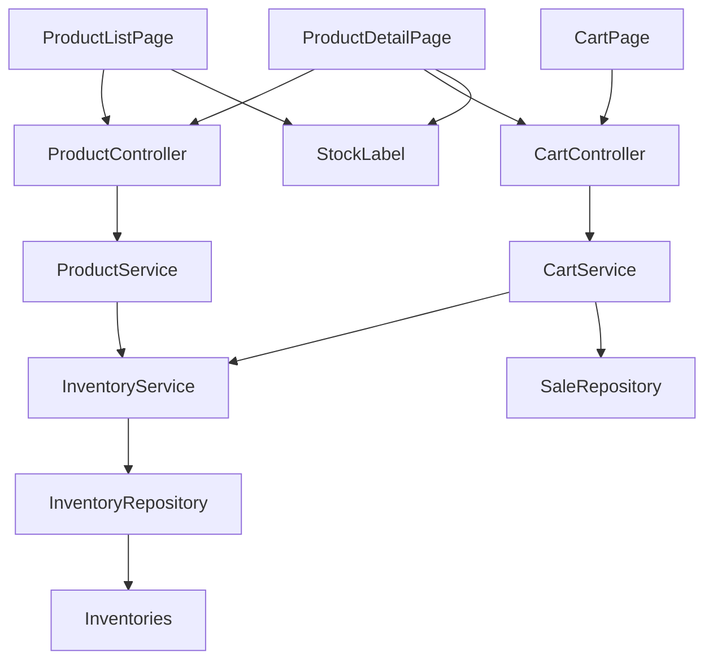
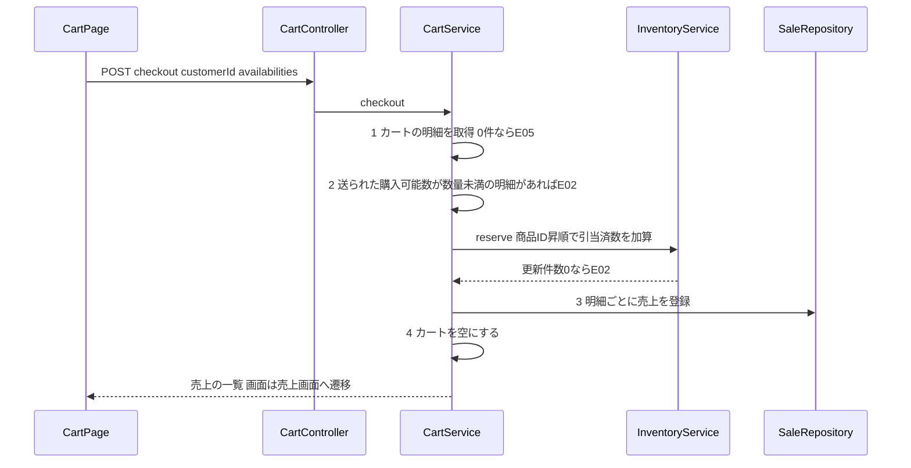
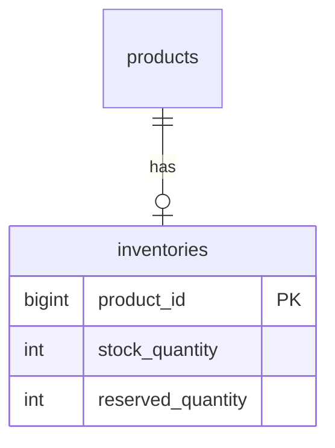

# Design Document

## Overview

**Purpose**: この機能は、文房具 EC のお客様に商品ごとの購入可能数を見せ、購入可能数を超える数量をカートに入れさせず、購入確定のときに在庫を引当てる。
**Users**: お客様は商品一覧・商品詳細・カートで購入可能数を確かめて買う。店の担当者は、購入確定のときの価格で売上が残り、引当済数が買われた分だけ増えることを確かめる。
**Impact**: 既存の EC に、在庫の表（`inventories`）と在庫の service を足し、`CartService` の追加と購入確定に在庫の検査を差し込む。商品マスタ、売上の登録の計算、エラー表示の形は変えない。

### Goals
- 商品ごとの在庫数と引当済数を、商品マスタとは別に保持し、購入可能数を 1 か所で求める（1.1-1.5）
- 一覧・詳細・カートが同じ購入可能数を見せ、カート追加と購入確定が同じ基準で検査する（2.1-4.7、6.1-6.8）
- 購入確定の引当と売上の登録を 1 つのトランザクションにし、失敗したら全明細を戻す（6.4、7.6）
- 同時の購入確定で引当済数の加算を失わない（6.6）

### Non-Goals
- 決済、出荷時の在庫数と引当済数の減算、入荷画面、税の計算
- 商品マスタの名前と価格の変更
- 購入確定の時点の在庫の読み直し（要件 6.3 が禁じている）
- 在庫の履歴、引当の取り消し API

## Boundary Commitments

### This Spec Owns
- 在庫（`inventories`）の定義、購入可能数の算出、引当済数の加算
- 商品一覧・商品詳細・カート画面の API が返す購入可能数
- カート追加の在庫の検査、購入確定の在庫の検査と引当
- エラー E02（在庫が足りません）の定義と、E01-E05 とエラーコードの対応の明記
- 在庫の表示部品（`StockLabel`）と、3 つの画面の変更

### Out of Boundary
- 商品マスタ（`products`）の列と更新。名前と価格は既存のとおり読むだけ
- 売上の登録の計算と、売上の画面（`SalesPage`）の表示
- 出荷時の減算、入荷、決済
- 講座の予約・購買申請・定期便の各業務

### Allowed Dependencies
- `ProductRepository`（商品の存在と価格の読み取り）。`InventoryService` を経由しない商品の読み取りは `CartService` と `ProductService` が従来どおり行う
- `CartRepository`・`CartItemRepository`・`SaleRepository`（既存のまま）
- 層の向きは controller → service → repository → entity。`InventoryService` は `CartService` と `ProductService` から呼ばれ、逆の参照はしない。他の業務（reservation・approval・billing）のクラスは参照しない

### Revalidation Triggers
- `ProductView`・`CartItemView` の項目、または `POST /api/cart/checkout` のリクエストの形を変えるとき（画面と API の両方を再確認する）
- `inventories` の列の意味（特に購入可能数の算出式）を変えるとき
- 出荷の機能を足して在庫数と引当済数を減算するとき（`reserved_quantity` の更新の経路が増える）
- エラーコードの enum 名やメッセージを変えるとき

## Architecture

### Existing Architecture Analysis
- EC は `com.example.ecsite` 直下に controller・service・repository・entity・dto・exception を置く。`CartService` がカートと購入確定の業務ルールを持ち、controller は入出力だけを扱う
- 同時更新は、加算式の native UPDATE（`CourseRepository.takeSeat` など）で行う型が既にある
- エラーは `CartException(ErrorCode)` を投げ、`ApiExceptionHandler` が `{ code, message }` で返す。画面は `message` を表示する
- 維持するもの: 層の規則、`ErrorCode` と `ApiExceptionHandler` の形、`checkout` の売上の登録の処理

### Architecture Pattern & Boundary Map



**Architecture Integration**:
- Selected pattern: 既存の 4 層に、在庫の entity・repository・service を EC の直下へ足す
- Domain/feature boundaries: 在庫の読み書きは `InventoryService` だけが行う。カートと売上の組み立ては `CartService` が持つ
- Existing patterns preserved: 加算式の native UPDATE、`CartException` と `ErrorCode`、`@Transactional` での一括の巻き戻し
- New components rationale: 購入可能数の算出と引当済数の加算を 1 か所に集め、`ProductService` と `CartService` の両方が同じ基準を使えるようにする
- Steering compliance: 層の規則（structure.md）、同時更新の規約（testing.md）、Flyway での表の定義（database.md）

### Technology Stack

| Layer | Choice / Version | Role in Feature | Notes |
|-------|------------------|-----------------|-------|
| Frontend | React 19、TypeScript 5.9、React Router 7 | 一覧・詳細・カートの表示と入力の上限 | 新しいライブラリは足さない |
| Backend | Spring Boot 4.1、Spring Data JPA、Java 25 | 在庫の検査と引当 | 既存のまま |
| Data | PostgreSQL 18、Flyway | `inventories` の定義 | V6 を足す |

## File Structure Plan

### Directory Structure
```
backend/src/main/java/com/example/ecsite/
├── entity/Inventory.java               # 在庫数と引当済数。購入可能数の算出式を持つ
├── repository/InventoryRepository.java # 在庫の読み取りと、引当済数の加算式 UPDATE
├── service/InventoryService.java       # 購入可能数の取得と、引当済数の加算
backend/src/main/resources/db/
├── migration/V6__create_inventory_table.sql  # inventories の定義
└── sample/R__sample_inventory.sql            # 開発用の在庫のサンプル
frontend/src/components/StockLabel.tsx  # 購入可能数の表示（一覧と詳細で共通）
backend/src/test/java/com/example/ecsite/
├── EcTestBase.java                     # EC のテストの共通の土台（reset とサービスの取得）
├── InventoryAvailabilityTest.java      # 1.1-1.5
├── ProductStockApiTest.java            # 2.1-2.3、3.1 の API 側
├── CartAddStockTest.java               # 4.1-4.7
├── CartRemoveStockTest.java            # 5.1-5.3
├── CheckoutReserveTest.java            # 6.1-6.5、7.1-7.6、8.1-8.2
└── CheckoutConcurrencyTest.java        # 6.6
```

### Modified Files
- `backend/.../service/CartService.java` — `addToCart` に在庫の検査（手順 3）を足す。`checkout` に明細ごとの購入可能数の受け取り、検査、引当を足す。`toViews` に `availableQuantity` を足す
- `backend/.../service/ProductService.java` — `toView` に `availableQuantity` を足し、一覧は商品 ID の一括取得で求める
- `backend/.../controller/CartController.java` — `CheckoutRequest` に `availabilities` を足す
- `backend/.../dto/ProductView.java`・`dto/CartItemView.java` — `availableQuantity` を足す
- `backend/.../exception/ErrorCode.java` — `INSUFFICIENT_STOCK`（409、「在庫が足りません」）を足す
- `backend/src/test/.../TestDataHelper.java` — 商品と在庫の作成、引当済数の取得、`reset` の TRUNCATE に `inventories` を足す
- `frontend/src/pages/ProductListPage.tsx`・`ProductDetailPage.tsx`・`CartPage.tsx` — 要件 2・3・6・8 の表示と入力の変更

## System Flows

購入確定の流れ（要件 6.1-6.8、7.1-7.6）。



- 手順 1 から 4 は 1 つの `@Transactional` に入れる。`CartException` は RuntimeException なので、どの段階で失敗しても引当済数・売上・カートの全てが戻る（6.4、7.6）
- 検査は、リクエストで送られた購入可能数だけで行う。`inventories` の `stock_quantity` は読まない（6.3）
- 引当済数の UPDATE は、検査の通過後に明細の数だけ実行する。1 件でも更新件数が 0 なら E02 を投げ、それまでの更新を戻す

## Requirements Traceability

| Requirement | Summary | Components | Interfaces | Flows |
|-------------|---------|------------|------------|-------|
| 1.1 | 在庫を商品と別に保持 | Inventory、V6 | `inventories` | - |
| 1.2 | 購入可能数 = 在庫数 - 引当済数 | Inventory、InventoryService | `availableQuantity` | - |
| 1.3 | 在庫の行が無ければ 0 | InventoryService | `availableQuantity` | - |
| 1.4 | 差が負なら 0 | Inventory | `availableQuantity()` | - |
| 1.5 | 在庫数 < 引当済数を許容 | V6（CHECK は各列 >= 0 のみ） | `inventories` | - |
| 2.1 | 一覧は名前と価格を既存のとおり表示 | ProductListPage | `GET /api/products` | - |
| 2.2 | 購入可能数 > 0 は「購入できる数: n」 | StockLabel、ProductService | `ProductView.availableQuantity` | - |
| 2.3 | 購入可能数 0 は赤字「在庫切れ」 | StockLabel | `ProductView.availableQuantity` | - |
| 3.1 | 詳細も一覧と同じ表示 | StockLabel、ProductDetailPage | `GET /api/products/{id}` | - |
| 3.2 | 数量入力は 1 から購入可能数 | ProductDetailPage | `ProductView.availableQuantity` | - |
| 3.3 | 購入可能数 0 は追加を押せない（グレー） | ProductDetailPage | `ProductView.availableQuantity` | - |
| 4.1 | 追加の検査を E01 → E03 → E02 の順に行う | CartService | `addToCart` | - |
| 4.2 | 数量 < 1 は E01 | CartService | `addToCart` | - |
| 4.3 | 商品なしは E03 | CartService | `addToCart` | - |
| 4.4 | カート内数量 + 追加 > 購入可能数は E02 | CartService、InventoryService | `addToCart`、`availableQuantity` | - |
| 4.5 | 同じ商品は数量を加算 | CartService | `addToCart`（既存） | - |
| 4.6 | 追加後にカート画面へ遷移 | ProductDetailPage | 既存の `navigate("/cart")` | - |
| 4.7 | 追加は在庫数も引当済数も変えない | CartService | `addToCart` は InventoryService の更新を呼ばない | - |
| 5.1 | 削除でカートから外す | CartService | `removeFromCart`（既存） | - |
| 5.2 | カートに無ければ E04 | CartService | `removeFromCart`（既存） | - |
| 5.3 | 削除は在庫を変えない | CartService | `removeFromCart` は InventoryService を呼ばない | - |
| 6.1 | 取得 → 検査と引当 → 売上 → カートを空に | CartService | `checkout` | 購入確定 |
| 6.2 | 明細 0 件は E05、在庫も売上も変えない | CartService | `checkout` | 購入確定 |
| 6.3 | 検査はカート画面から送られた購入可能数で行う | CartService、CartController | `CheckoutRequest.availabilities`、`CartItemView.availableQuantity` | 購入確定 |
| 6.4 | 1 件でも不足なら E02 と全体の巻き戻し | CartService | `checkout`（`@Transactional`） | 購入確定 |
| 6.5 | 引当済数 = その時点の値 + 数量 | InventoryRepository | `addReserved` | 購入確定 |
| 6.6 | 同時の購入確定で加算を失わない | InventoryRepository | `addReserved`（加算式 UPDATE） | - |
| 6.7 | 処理中は購入確定を押せない | CartPage | `submitting` の状態 | - |
| 6.8 | 成功したら売上画面へ遷移 | CartPage | `navigate("/sales")` | 購入確定 |
| 7.1 | 検査後に明細ごとに売上を 1 件登録 | CartService | `checkout` | 購入確定 |
| 7.2 | 単価は購入確定時の商品マスタの価格 | CartService | `checkout`（既存の `Product.getPrice()`） | 購入確定 |
| 7.3 | 金額 = 単価 × 数量 | CartService | `checkout`（既存） | 購入確定 |
| 7.4 | 日時は購入確定の日時 | CartService | `checkout`（既存の `now`） | 購入確定 |
| 7.5 | 価格が変わっても登録済みの売上は不変 | Sale（`unit_price` に値を保存） | `sale` 表 | - |
| 7.6 | 途中で失敗したら売上を残さない | CartService | `@Transactional` | 購入確定 |
| 8.1 | エラーは画面下部に赤字で表示 | ProductDetailPage、CartPage | `{ code, message }` | - |
| 8.2 | E01-E05 にメッセージを対応させる | ErrorCode | 下表 | - |

エラーコードの対応（8.2）。API は `{ code: <enum 名>, message }` を返す。

| 要件のコード | enum 名 | HTTP | メッセージ |
|---|---|---|---|
| E01 | INVALID_QUANTITY | 400 | 数量が正しくありません |
| E02 | INSUFFICIENT_STOCK（新規） | 409 | 在庫が足りません |
| E03 | PRODUCT_NOT_FOUND | 404 | 商品がありません |
| E04 | NOT_IN_CART | 404 | カートに入っていません |
| E05 | CART_EMPTY | 409 | カートが空です |

## Components and Interfaces

| Component | Domain/Layer | Intent | Req Coverage | Key Dependencies (P0/P1) | Contracts |
|-----------|--------------|--------|--------------|--------------------------|-----------|
| Inventory | entity | 在庫数と引当済数を持ち、購入可能数を返す | 1.1-1.5 | - | State |
| InventoryRepository | repository | 在庫の読み取りと引当済数の加算 | 1.1、6.5、6.6 | Inventory (P0) | Service |
| InventoryService | service | 購入可能数の取得と引当済数の加算の入口 | 1.2-1.4、4.4、6.5、6.6 | InventoryRepository (P0) | Service |
| ProductService | service | 商品に購入可能数を付けて返す | 2.2、2.3、3.1 | InventoryService (P0)、ProductRepository (P0) | API |
| CartService | service | 追加の検査、購入確定の検査と引当と売上 | 4.1-4.7、5.1-5.3、6.1-6.4、7.1-7.6 | InventoryService (P0)、SaleRepository (P0) | Service、API |
| CartController | controller | 購入確定のリクエストの受け渡し | 6.3 | CartService (P0) | API |
| ErrorCode | exception | E02 の追加 | 8.2 | - | - |
| StockLabel | UI | 購入可能数の表示 | 2.2、2.3、3.1 | - | - |
| 3 つの画面 | UI | 表示と入力の制限 | 2.1-3.3、4.6、6.7、6.8、8.1 | API (P0) | - |

### Backend

#### Inventory

| Field | Detail |
|-------|--------|
| Intent | 商品ごとの在庫数と引当済数を持つ |
| Requirements | 1.1、1.2、1.4、1.5 |

**Responsibilities & Constraints**
- `product_id` を主キーとする。`stockQuantity` と `reservedQuantity` は `int`
- `availableQuantity()` は `max(0, stockQuantity - reservedQuantity)` を返す（`long` で引いてから丸め、桁あふれを避ける）
- `reservedQuantity` は加算式の UPDATE でだけ変える。エンティティの保存では更新しない（`@Column(updatable = false)`）

**Contracts**: State [x]

##### State Management
- State model: `stockQuantity: Int`、`reservedQuantity: Int`。`stockQuantity < reservedQuantity` を正当な状態とする（1.5）
- Persistence & consistency: DB の CHECK は `stock_quantity >= 0` と `reserved_quantity >= 0` だけ
- Concurrency strategy: 引当済数の更新は行ロックを取る加算式の UPDATE

#### InventoryRepository / InventoryService

| Field | Detail |
|-------|--------|
| Intent | 購入可能数の取得と、引当済数の加算の入口を 1 か所にする |
| Requirements | 1.2、1.3、1.4、4.4、6.5、6.6 |

**Responsibilities & Constraints**
- 購入可能数を求める処理を、`InventoryService` だけが持つ。行が無い商品は 0
- 引当済数の加算は、`InventoryRepository.addReserved` の native UPDATE で行う
- トランザクションは呼び出し元（`CartService.checkout`）のものに参加する

**Dependencies**
- Inbound: ProductService — 一覧・詳細の購入可能数 (P0)
- Inbound: CartService — 追加の検査、購入確定の引当、カート画面の購入可能数 (P0)
- Outbound: InventoryRepository (P0)

**Contracts**: Service [x]

##### Service Interface
```java
public class InventoryService {
    /** 在庫の行が無ければ 0。差が負でも 0。 */
    int availableQuantity(long productId);

    /** 指定した商品 ID の購入可能数。行が無い商品も 0 としてキーに含める。 */
    Map<Long, Integer> availableQuantities(Collection<Long> productIds);

    /**
     * 引当済数に quantity を加算する。
     * @return 在庫の行があって更新できたら true、行が無ければ false
     */
    boolean reserve(long productId, int quantity);
}
```
（公開メソッドの契約のみを示す。実装は `InventoryRepository` への委譲）
- Preconditions: `quantity >= 1`
- Postconditions: `reserve` が true を返したとき、`reserved_quantity` は更新前の値に `quantity` を加えた値になる。同時に呼ばれても加算は失われない
- Invariants: `stock_quantity` を変更しない

```java
// InventoryRepository
@Modifying(flushAutomatically = true, clearAutomatically = true)
@Query(value = "UPDATE inventories SET reserved_quantity = reserved_quantity + :quantity WHERE product_id = :productId",
        nativeQuery = true)
int addReserved(@Param("productId") Long productId, @Param("quantity") int quantity);
```
- `findAllById(productIds)` で一括取得し、`availableQuantities` を組み立てる

#### CartService

| Field | Detail |
|-------|--------|
| Intent | カートの追加・削除と、購入確定の在庫の検査・引当・売上の登録 |
| Requirements | 4.1-4.7、5.1-5.3、6.1-6.4、7.1-7.6 |

**Responsibilities & Constraints**
- `addToCart` は E01 → E03 → E02 の順に検査してから追加する。E02 の条件は「カート内の同じ商品の数量 + 追加する数量 > `availableQuantity`」。カートの内容も在庫も、検査に失敗したら変えない
- `removeFromCart` と `addToCart` は `InventoryService.reserve` を呼ばない（4.7、5.3）
- `checkout` は次の順で行う
  1. カートの明細を取得。0 件（カート無しを含む）なら E05
  2. 明細ごとに、リクエストの `availabilities` から同じ productId の値を引く。値が無ければ 0 とみなす。値が数量より小さい明細が 1 件でもあれば E02
  3. 明細を商品 ID の昇順に並べ、`InventoryService.reserve(productId, quantity)` を呼ぶ。false が返ったら E02
  4. 明細ごとに売上を登録する（既存の処理。単価は購入確定時の `Product.getPrice()`、金額は単価 × 数量、日時は購入確定の日時）
  5. カートを空にする
- すべてを 1 つの `@Transactional` に入れる。CartException で全体が戻る

**Dependencies**
- Outbound: InventoryService — 購入可能数と引当 (P0)
- Outbound: SaleRepository、CartItemRepository、ProductRepository (P0)

**Contracts**: Service [x] / API [x]

##### Service Interface
```java
public record AvailabilityInput(Long productId, int availableQuantity) {}

List<CartItemView> addToCart(Long customerId, Long productId, int quantity);
List<CartItemView> getCartItems(Long customerId);   // availableQuantity を含める
void removeFromCart(Long customerId, Long productId);
List<SaleView> checkout(Long customerId, List<AvailabilityInput> availabilities);
```
- Preconditions: `availabilities` は null を許し、null は空として扱う
- Postconditions（成功）: 引当済数が明細の数量だけ増え、明細ごとに売上が 1 件登録され、カートが空になる
- Postconditions（失敗）: 在庫・売上・カートは呼び出し前と同じ
- Errors: `CartException` — INVALID_QUANTITY、PRODUCT_NOT_FOUND、INSUFFICIENT_STOCK、NOT_IN_CART、CART_EMPTY

##### API Contract
| Method | Endpoint | Request | Response | Errors |
|--------|----------|---------|----------|--------|
| POST | /api/cart | `{ customerId, productId, quantity }` | 201 `CartItemView[]` | 400 E01、404 E03、409 E02 |
| GET | /api/cart/items?customerId= | - | `CartItemView[]` | - |
| DELETE | /api/cart/items/{productId}?customerId= | - | 204 | 404 E04 |
| POST | /api/cart/checkout | `{ customerId, availabilities: [{ productId, availableQuantity }] }` | 201 `SaleView[]` | 409 E05、409 E02 |

#### ProductService

- `getAllProducts` は商品の ID を集めて `availableQuantities` を 1 回呼び、`ProductView` に `availableQuantity` を付ける。`getProductById` は `availableQuantity` を呼ぶ
- Implementation Note: `ProductView(Long id, String name, int price, String imageUrl, int availableQuantity)`、`CartItemView(Long productId, String productName, String imageUrl, long unitPrice, int quantity, int availableQuantity)`

### Frontend

#### StockLabel
- `props: { availableQuantity: number }`。0 より大きければ「購入できる数: n」、0 なら赤字（`#d32f2f`）の「在庫切れ」を返す

#### ProductListPage / ProductDetailPage / CartPage
- ProductListPage: 商品名と価格を既存のとおり表示し、その下に `StockLabel` を置く（2.1-2.3）
- ProductDetailPage: `StockLabel` を表示し、数量入力に `min=1`・`max=availableQuantity` を付ける。`availableQuantity` が 0 のときは「カートに追加」を `disabled` にしてグレーで表示する（3.1-3.3）。エラーは既存どおり画面下部に赤字で表示する（8.1）
- CartPage:
  - 取得した明細の `availableQuantity` を保持し、購入確定のときに `availabilities`（`{ productId, availableQuantity }` の配列）として送る（6.3）
  - ボタンの文言を「購入確定」にし、処理中は `disabled` にする（6.7）
  - 成功したら `navigate("/sales")`（6.8）。失敗したらメッセージを画面下部に赤字で表示する（8.1）。現在カート画面のメッセージは上部に出ているため、下部の赤字に直す。成功の文言「購入が完了しました」は売上画面へ遷移するため不要になる
- Implementation Note: 画面は業務ルールを持たない。数量の上限は入力の補助であり、検査は常に API が行う

## Data Models

### Logical Data Model



- `inventories.product_id` は `products.id` への外部キー（主キーを兼ねる）。商品 1 件に在庫は 0 または 1 行
- 行が無い商品の購入可能数は 0
- 購入可能数 = `max(0, stock_quantity - reserved_quantity)`（算出値であり、保存しない）

### Physical Data Model

```sql
-- V6__create_inventory_table.sql
CREATE TABLE inventories (
    product_id        BIGINT  PRIMARY KEY REFERENCES products (id),
    stock_quantity    INTEGER NOT NULL CHECK (stock_quantity >= 0),
    reserved_quantity INTEGER NOT NULL CHECK (reserved_quantity >= 0)
);
```
- `stock_quantity >= reserved_quantity` の CHECK は付けない（1.5）
- サンプル: `db/sample/R__sample_inventory.sql` が `products` の 1-20 に在庫を入れる（`ON CONFLICT (product_id) DO NOTHING`）。購入可能数が十分ある商品、少ない商品（在庫 10・引当 8）、0 の商品（在庫 3・引当 3）、在庫数 < 引当済数の商品、行が無い商品を含める

## Error Handling

### Error Strategy
- 検査の失敗は `CartException(ErrorCode)` で表し、`ApiExceptionHandler` が `{ code, message }` と HTTP 状態で返す（既存の型）。画面は `message` を表示する
- `@Transactional` が CartException で巻き戻すため、在庫・売上・カートが中途半端に残らない

### Error Categories and Responses
- **User Errors**: E01（400）、E03（404）、E04（404）— 入力の誤り
- **Business Logic Errors**: E02（409、在庫不足）、E05（409、カートが空）— 状態との衝突

### Monitoring
- 既存のログの方針に従い、この機能で足すものは無い

## Testing Strategy

steering testing.md に従い、受入基準ごとに 1 つ以上の JUnit 5 + Spring Boot Test を作り、実装より先に書く。画面（React）のテストは作らない。時刻は既存の `MutableClock` が使える範囲で扱う（この機能は時刻を検査しない）。

### Unit / Service Tests
- `InventoryAvailabilityTest`: 在庫 10・引当 0 で 10（1.2）、在庫 10・引当 8 で 2（1.2）、在庫 3・引当 3 で 0（1.2）、行が無い商品で 0（1.3）、在庫 3・引当 5 で 0（1.4）、在庫 3・引当 5 の行を保存できる（1.5）、在庫と商品の名前・価格が別の表にある（1.1）
- `CartAddStockTest`: 数量 0 で E01（4.2）、存在しない商品で E03（4.3）、数量が不正で商品も存在しないとき E01 が先（4.1 の順序）、商品が存在せず数量超過のときは E03 が先（4.1）、カート内 + 追加が購入可能数ちょうどで通る・1 超過で E02 かつカート不変（4.4）、同じ商品の再追加で数量が加算される（4.5）、追加の前後で在庫数・引当済数が同じ（4.7）
- `CartRemoveStockTest`: 削除でカートから消える（5.1）、カートに無い商品で E04（5.2）、削除の前後で在庫数・引当済数が同じ（5.3）

### Integration Tests（MockMvc）
- `ProductStockApiTest`: `GET /api/products` と `/api/products/{id}` が確認用データ A-D の購入可能数（10・5・2・0）と名前・価格を返す（2.1、2.2、2.3 の API 側、3.1）。`GET /api/cart/items` が明細ごとの `availableQuantity` を返す（6.3）
- `CheckoutReserveTest`:
  - 明細 0 件で E05、在庫も売上も変わらない（6.2）
  - 全明細が足りるとき、引当済数が明細の数量だけ増え、売上が明細ごとに 1 件、カートが空になる（6.1、6.5、7.1）
  - 画面の値（送った購入可能数）が数量以上なら、DB の実際の購入可能数が不足でも検査は通り、引当済数が加算される（6.3）
  - 送った購入可能数が数量未満の明細が 1 件でもあれば、E02 で 全商品の引当済数・売上・カートが前の状態のまま（6.4、7.6）
  - 明細に対応する購入可能数が送られていないときは E02（research.md の決定）
  - 引当の途中で在庫の行が無い商品に当たると E02 になり、先に更新した商品の引当済数も戻る（6.4、7.6）
  - 売上の単価が購入確定時の商品の価格で、金額 = 単価 × 数量、日時が購入確定の日時（7.2、7.3、7.4）。登録後に価格を変えても売上が変わらない（7.5）
  - 各エラーで `{ code, message }` が表の enum 名とメッセージで返る（8.1 の API 側、8.2）

### Concurrency Tests
- `CheckoutConcurrencyTest`: 10 人が同じ商品を同時に購入確定（数量 1）し、引当済数が元の値 + 10 になる（6.6）。逆順の 2 商品を 2 人が同時に購入確定しても止まらず、両方の加算が反映される（6.6）。`ReservationConcurrencyTest` の `CountDownLatch` の型に合わせる

### 画面の確認（自動テストの対象外、手動で確かめる）
- 一覧で購入可能数が 0 より大きい商品に「購入できる数: n」、0 の商品に赤字の「在庫切れ」（2.2、2.3）
- 詳細で数量入力の上限が購入可能数、購入可能数 0 の商品で「カートに追加」がグレーで押せない（3.2、3.3）
- 追加後にカート画面へ遷移する（4.6）
- 購入確定の処理中にボタンが押せず、成功したら売上画面へ遷移し、失敗したら下部に赤字で表示される（6.7、6.8、8.1）

## Security Considerations
- 購入確定の在庫の検査は、クライアントから送られる購入可能数に依存する（要件 6.3）。送られた値が実際の在庫と食い違う場合に、`reserved_quantity` が `stock_quantity` を超える。この状態は要件 1.4・1.5 が許容しており、design では変えない。見直す場合は requirements.md の 6.3 から変更する（research.md の Risks に記録）
- 認証は既存のまま（`customerId` をリクエストで受ける）。この機能では変えない

## Performance & Scalability
- 商品一覧の購入可能数は、商品 ID の一括取得 1 回で求める（商品ごとの問い合わせにしない）
- 引当済数の UPDATE は行ロックを取る。商品 ID の昇順で更新して、複数明細の待ち合いを避ける
