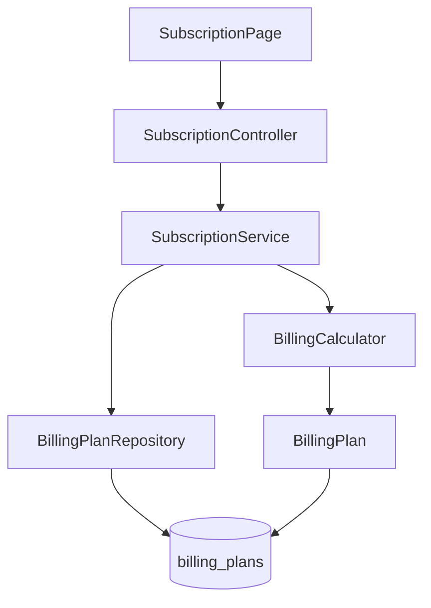
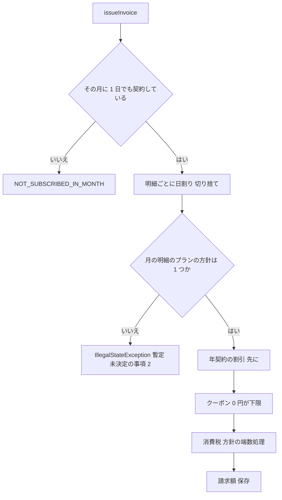

# Design Document

## Overview

**Purpose**: 定期便の課金に、月額 8,000 円（税抜き）のプレミアムプランを加える。
**Users**: お客様は、申し込みとプラン変更でプレミアムを選ぶ。店の担当者は、プレミアムを契約している月の請求書を作る。
**Impact**: 既存の `billing` パッケージの計算を、「プランごとの割引率と消費税の端数処理」を読む形に変える。ライト・スタンダードの金額は変えない。

プレミアムとほかのプランの違いは、月額（8,000 円）、年契約の割引率（15%）、消費税の 1 円未満（四捨五入）の 3 つだけである。この 3 つを `billing_plans` の列として持たせ、`BillingCalculator` がプランの値を読む。プランごとの分岐は書かない。

### Goals
- プレミアムを、プラン一覧・申し込み・プラン変更で使える
- プレミアムの請求額が、requirements の業務の決まりの順序と端数のとおりになる
- ライト・スタンダードの請求額と、作成済みの請求書を変えない

### Non-Goals
- 未決定の事項 1・2・3 の解消（割引の端数、プレミアムと別プランが同じ月にある請求書、四捨五入の範囲）
- 支払い、配送、プレミアム以外のプランの追加
- 解約と請求書の重複防止の決まりそのものの変更

## Boundary Commitments

### This Spec Owns
- プレミアムのプランの定義（`billing_plans` の行と、プランごとの割引率・税の端数の列）
- プランの属性を読んで請求額を求める `BillingCalculator` の変更
- プラン変更の画面の文言（選べるプランの案内）

### Out of Boundary
- `subscription-billing` が定めた流れ（契約・プラン変更・解約・請求書の作成、1 か月 1 通の制約、クーポンの金額と条件）。プレミアムに当てはまることを確かめるだけで、決まりは変えない
- 未決定の事項 1・2・3 に答えを出すこと。本設計は、答えを入れる場所を 1 か所ずつ用意するだけにする
- ライト・スタンダードの月額と計算

### Allowed Dependencies
- 同じ `billing` パッケージの既存のクラス（`SubscriptionService`、`PlanPeriod`、`InvoiceView`、`BillingError`）
- Flyway のマイグレーション。新しいライブラリは足さない
- ほかの業務のパッケージには依存しない

### Revalidation Triggers
- 未決定の事項 1・2・3 のどれかが決まったとき（`annualDiscountOf`、`policyOf`、`billing_plans.tax_rounding` の値を見直す）
- `billing_plans` の列の意味や `InvoiceView` の形が変わったとき（`subscription-billing` の画面と API の利用側を確かめる）
- クーポンの金額や適用の順序が変わったとき

## Architecture

### Existing Architecture Analysis
- `BillingCalculator.calculate` は DB に触らない静的メソッドで、日割り → 年契約の割引 → クーポン → 消費税 の順に long で求める。割引率 10% と税の切り捨ては、定数と整数の割り算として埋まっている
- 明細は `PlanPeriod` ごとに作り、`PlanPeriod.getPlan()` から `BillingPlan` の値に届く
- `GET /api/billing-plans` は `billing_plans` の全行を返し、画面の選択肢はそれを描く
- 請求書は金額を保存した行で、作成後に再計算しない

### Architecture Pattern & Boundary Map



- **Selected pattern**: プランの属性をデータ（マスタの列）にして、計算が読む。差が数値 2 つだけなので、Strategy のようなクラスは作らない
- **Existing patterns preserved**: controller は入出力だけ、業務ルールは service と calculator に置く。エラーは `BillingError`。金額は long。マスタはマイグレーションで入れる
- **New components rationale**: 新しいクラスは作らない。`TaxRounding` の enum 1 つだけを足す
- **Steering compliance**: 金額は long（整数演算の四捨五入）。書かれていない端数は決めず、未決定として残す

### Technology Stack

| Layer | Choice / Version | Role in Feature | Notes |
|-------|------------------|-----------------|-------|
| Frontend | React 19 / TypeScript 5.9 | プラン変更の入力案内の文言の修正 | 選択肢は API から取るため変更なし |
| Backend | Spring Boot 4.1 / Java 25 | 計算とプランの読み出し | 新規ライブラリなし |
| Data | PostgreSQL 18 / Flyway | `billing_plans` の列の追加とプレミアムの行 | V6 を追加 |

## File Structure Plan

### Directory Structure
```
backend/src/main/
├── java/com/example/ecsite/billing/
│   └── entity/TaxRounding.java        # 新規: FLOOR / HALF_UP の enum
└── resources/db/migration/
    └── V7__add_premium_plan.sql       # 新規: 列の追加とプレミアムの行
backend/src/test/java/com/example/ecsite/billing/
└── PremiumPlanTest.java               # 新規: Requirement 1〜5, 7 のテスト
```

### Modified Files
- `billing/entity/BillingPlan.java` - `annualDiscountPercent`（long）と `taxRounding`（`TaxRounding`）を持つ
- `billing/service/BillingCalculator.java` - 定数 `ANNUAL_DISCOUNT_PERCENT` をやめ、プランの値で割引と税を求める。`annualDiscountOf`（割引の端数の差し替え点）と `policyOf`（月の中の方針を 1 つに定める）を足す
- `frontend/src/pages/SubscriptionPage.tsx` - `window.prompt` の文言を `LIGHT / STANDARD / PREMIUM` にする
- `backend/src/test/java/com/example/ecsite/billing/InvoiceProrationTest.java`、`DiscountTest.java` - 既存の期待値は変えない。Requirement 6.1 から 6.4 に対応するテストが足りない場合だけ、同じクラスにテストを足す
- `backend/src/main/java/com/example/ecsite/billing/controller/SubscriptionController.java` - 変更しない（`plans()` は新しい列を返さない。画面は月額と名前だけを使う）

## System Flows

請求書の作成は既存の流れのまま、計算の中で方針を決める。



`policyOf` は、月の明細のプランから (割引率, 税の端数) の組を集め、1 種類ならそれを返す。2 種類以上なら止める。ライト + スタンダードは同じ組なので、今の動作のまま通る。

## Requirements Traceability

| Requirement | Summary | Components | Interfaces | Flows |
|-------------|---------|------------|------------|-------|
| 1.1 | プラン一覧に 3 つ | V6、`BillingPlan` | `GET /api/billing-plans` | - |
| 1.2 | プレミアムの月額 8,000 円 | V6 | `billing_plans.monthly_fee` | - |
| 2.1 | 画面の選択肢にプレミアム | `SubscriptionPage`（API から取得） | `GET /api/billing-plans` | - |
| 2.2 | プレミアムで申し込み | `SubscriptionService.subscribe` | `POST /api/subscriptions` | - |
| 2.3 | プレミアムへ変更 | `SubscriptionService.changePlan`、`SubscriptionPage` の文言 | `POST /api/subscriptions/{id}/change-plan` | - |
| 2.4 | プレミアムからプレミアムを拒否 | `SubscriptionService.changePlan`（`SAME_PLAN`） | 同上 | - |
| 3.1〜3.5 | 日割り・クーポン | `BillingCalculator.calculate` | `InvoiceView` | 請求書の作成 |
| 4.1〜4.3 | 15% の割引、クーポンより先 | `BillingCalculator`（`annualDiscountOf`） | `billing_plans.annual_discount_percent` | 請求書の作成 |
| 5.1〜5.3 | 税の四捨五入 | `BillingCalculator`（`TaxRounding.HALF_UP`） | `billing_plans.tax_rounding` | 請求書の作成 |
| 6.1〜6.4 | 既存プランの金額 | V6 の既存行の値（10 と FLOOR） | 既存の `InvoiceView` | 請求書の作成 |
| 6.5 | 作成済みの請求書を変えない | 請求書は保存済みの金額。再計算しない | `invoices` | - |
| 7.1 | 同月の二重発行を拒否 | `SubscriptionService.issueInvoice`（`ALREADY_ISSUED`） | `POST /api/subscriptions/{id}/invoices` | 請求書の作成 |
| 7.2 | 解約後の月を拒否 | `BillingCalculator` が null を返す → `NOT_SUBSCRIBED_IN_MONTH` | 同上 | 請求書の作成 |
| 7.3 | 解約日までの日割り | `BillingCalculator.calculate` | `InvoiceView.Line` | 請求書の作成 |
| 7.4 | 明細の記録 | `InvoiceLine`（既存） | `invoice_lines` | 請求書の作成 |

## Components and Interfaces

| Component | Layer | Intent | Req Coverage | Key Dependencies | Contracts |
|-----------|-------|--------|--------------|------------------|-----------|
| V7__add_premium_plan.sql | Data | 列の追加とプレミアムの行 | 1.1, 1.2, 6.1〜6.4 | V4 (P0) | State |
| BillingPlan / TaxRounding | Entity | プランの属性を持つ | 4, 5, 6 | billing_plans (P0) | State |
| BillingCalculator | Service | 属性を読んで請求額を求める | 3, 4, 5, 6, 7 | BillingPlan (P0) | Service |
| SubscriptionPage | UI | プラン変更の案内文 | 2.1, 2.3 | `/api/billing-plans` (P1) | - |

### Service

#### BillingCalculator

| Field | Detail |
|-------|--------|
| Intent | プランの属性に従って、順序どおりに請求額を求める |
| Requirements | 3.1〜3.5, 4.1〜4.3, 5.1〜5.3, 6.1〜6.4, 7.2, 7.3 |

**Responsibilities & Constraints**
- 順序は 日割り → 年契約の割引 → クーポン（0 円が下限）→ 消費税 → 請求額。変えない
- 日割りは `monthlyFee * days / daysInMonth`（切り捨て）のまま
- 定数 `ANNUAL_DISCOUNT_PERCENT` は削除する。外部から参照されていないか、実装時に確かめる
- double と float は使わない

##### Service Interface
```java
public final class BillingCalculator {
    /** その月に 1 日も契約していなければ null。 */
    public static InvoiceView calculate(Subscription subscription, YearMonth month);

    /** 年契約の割引。subtotal は 0 以上。端数は暫定で切り捨て（未決定の事項 1）。 */
    static long annualDiscountOf(long subtotal, long percent);

    /** 消費税。FLOOR は afterDiscount * 10 / 100、HALF_UP は (afterDiscount * 10 + 50) / 100。 */
    static long taxOf(long afterDiscount, TaxRounding rounding);

    /** 月の明細のプランの (割引率, 税の端数) が 1 種類ならそれを返す。2 種類以上なら IllegalStateException（未決定の事項 2）。 */
    static Policy policyOf(List<BillingPlan> plansInMonth);

    record Policy(long annualDiscountPercent, TaxRounding taxRounding) {}
}
```
- Preconditions: `afterDiscount >= 0`（クーポンの控除に 0 円の下限があるため満たす）
- Postconditions: 4.1 の 8,000 円 → 割引 1,200、6,800、税 680、請求額 7,480。5.2 の 4,387 円 → 税 439、請求額 4,826
- Invariants: ライト・スタンダードの結果は、変更の前後で同じ

### Data

#### V7__add_premium_plan.sql

```sql
ALTER TABLE billing_plans
    ADD COLUMN annual_discount_percent BIGINT      NOT NULL DEFAULT 10 CHECK (annual_discount_percent BETWEEN 0 AND 100),
    ADD COLUMN tax_rounding            VARCHAR(10) NOT NULL DEFAULT 'FLOOR' CHECK (tax_rounding IN ('FLOOR', 'HALF_UP'));

INSERT INTO billing_plans (code, name, monthly_fee, annual_discount_percent, tax_rounding)
VALUES ('PREMIUM', 'プレミアム', 8000, 15, 'HALF_UP');
```
- DEFAULT により、既存のライト・スタンダードは 10 と FLOOR になり、金額は変わらない
- 適用済みの V4 は書き換えない（database.md）

### UI

#### SubscriptionPage
- 選択肢は `/api/billing-plans` から描くため、プレミアムは自動で出る（2.1）
- 既定の選択（`STANDARD`）は変えない。`window.prompt` の案内文だけを直す

## Data Models

### Logical / Physical Data Model

| テーブル | 変更 | 内容 |
|---------|------|------|
| billing_plans | 列を 2 つ追加、1 行追加 | `annual_discount_percent`、`tax_rounding`、PREMIUM の行 |
| plan_periods | 変更なし | `plan_code` が外部キーのため、PREMIUM を指せる |
| invoices / invoice_lines | 変更なし | 金額の列は既存のまま。明細の `plan_code` に PREMIUM が入る |

- `invoices.after_discount >= 0` の制約は、クーポンの 0 円の下限（3.5）と整合する

## Error Handling

- 新しい理由コードは足さない。2.4 は `SAME_PLAN`、7.1 は `ALREADY_ISSUED`、7.2 は `NOT_SUBSCRIBED_IN_MONTH` で、既存の実装がそのまま当てはまる
- 方針が 1 つに定まらない月は `IllegalStateException`（HTTP では 500）で止める。仕様にない理由コードを作らないための暫定で、未決定の事項 2 が決まったら置き換える。金額を黙って出すより止めることを選ぶ

## Testing Strategy

受入基準 1 つにつき 1 つ以上のテストを `PremiumPlanTest` に作る（testing.md）。時刻は固定の Clock を使い、DB は ecsite_test を使う。

### Unit / Service Tests（`BillingTestBase` を使う）
- 1.1: プラン一覧が LIGHT・STANDARD・PREMIUM を月額つきで返す。1.2: PREMIUM が 8,000 円
- 2.2: PREMIUM で申し込むと、申し込んだ日からの期間が PREMIUM で記録される。2.3: STANDARD から PREMIUM へ変更日つきで変えると期間が分かれる。2.4: PREMIUM → PREMIUM が `SAME_PLAN`
- 3.1〜3.5: 9/1 開始の 10 月は 8,000・0・800・8,800。10/15 開始は小計 4,387。10/1 開始 + クーポンは 7,500・750・8,250。11 月はクーポンなしで 8,000。10/31 開始 + クーポンは小計 258、割引後 0、請求額 0
- 4.1〜4.3: 年契約は 1,200・6,800・680・7,480。年契約 + クーポンは 6,800 → 6,300、税 630、請求額 6,930。割引は年契約が先
- 5.1〜5.3: 10/15 開始は税 439（438.7 を四捨五入）、請求額 4,826。税は割引の後の金額にかける
- 7.1〜7.4: 同月の二重発行が `ALREADY_ISSUED`。10/10 解約後の 11 月が `NOT_SUBSCRIBED_IN_MONTH`。9/1 開始・10/10 解約の 10 月は小計 2,580。明細にプレミアムの期間・日数・金額が入る

### 回帰テスト（既存のクラス）
- 6.1: スタンダードの 10 月は 5,000・0・500・5,500。6.2: 年契約は割引 500、請求額 4,950。6.3: 10/15 開始は 2,741・274・3,015。6.4: ライトの年契約の割引は 10%
- 6.5: V6 を適用した後でも、作成済みの請求書の金額が変わらない（保存済みの行を読んで比べる）

### 作らないテスト
- 年契約の割引が割り切れない小計になる場合（未決定の事項 1）
- プレミアムとほかのプランが同じ月にある請求書の金額（未決定の事項 2）。方針が定まらない月が止まることだけを、暫定の保護として 1 つ確かめる

## Migration Strategy

1. V6 を適用する（既存の 2 行は DEFAULT で 10 と FLOOR になる）
2. 既存のテストを実行し、金額が変わらないことを確かめる
3. ロールバックが要る場合は、PREMIUM の行を使っている契約がないことを確かめてから、V6 を戻す別のマイグレーションを足す（適用済みの V6 は書き換えない）
