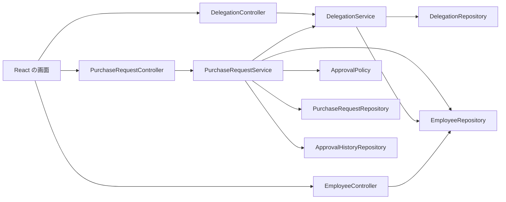
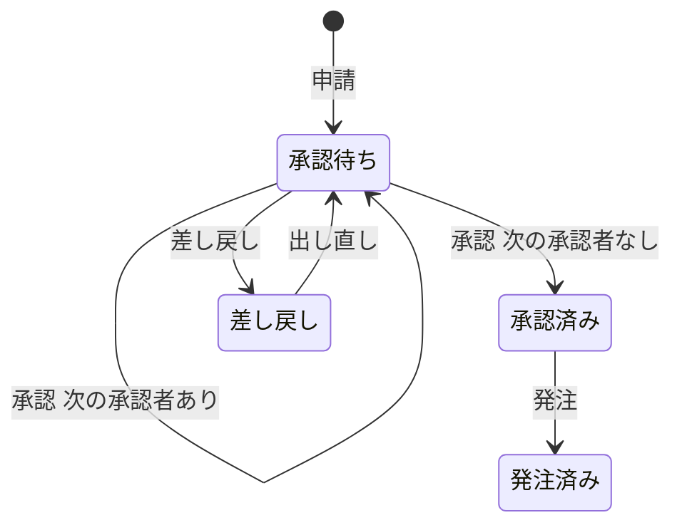
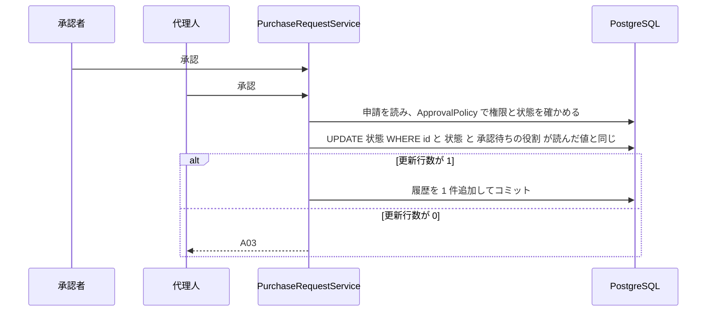

# Design Document

## Overview

**Purpose**: 法人の社員の購買申請を、決裁権限表に従って承認または差し戻し、承認された申請を購買部が発注済みにする。
**Users**: 担当者・課長・部長が申請する。課長・部長・役員が承認と差し戻しをする。購買部が発注する。承認者が期間を決めて代理人を設定する。
**Impact**: EC と同じプロジェクトに、`approval` パッケージと 5 つのテーブル(employee・purchase_request・purchase_request_item・approval_history・delegation)を足す。EC・講座の予約・定期便のクラスは変えない。

### Goals
- 申請金額と申請者の役割から、決裁権限表どおりに承認者の並びが決まる
- 承認・差し戻し・出し直し・発注が、状態・権限・理由を確かめたうえで 1 回だけ反映され、履歴が 1 件ずつ残る
- 同じ申請への同時の操作でも、状態と履歴が 1 回分になる
- 画面に表示する可否と、API が行う拒否の判定が同じ規則から出る

### Non-Goals
- 発注先へのデータの送信と支払い(発注は状態を「発注済み」にするところまで)
- 社員・部署・役割の登録と管理(`employee` は参照するだけで、書き込みの API を作らない)
- 要件の「未決定」7 件の実装(Open Questions に置き場所だけを残す)

## Boundary Commitments

### This Spec Owns
- 購買申請・明細・履歴・代理設定のテーブルと、状態の遷移(承認待ち・差し戻し・承認済み・発注済み)
- 決裁権限表による承認者の並びと、操作者の権限の判定
- 申請・承認・差し戻し・出し直し・発注・代理設定・承認一覧の API
- `employee` テーブルの定義と、サンプルデータ(参照専用。中身の管理は持たない)

### Out of Boundary
- 社員・部署・役割の登録と管理、発注先への送信、支払い
- 顧客の認証(EC の既存のログインをそのまま使う)
- EC・講座の予約・定期便の課金(それぞれ別の spec)
- requirements.md の「未決定」7 件の決定(Open Questions を参照)

### Allowed Dependencies
- 既存の customer テーブル(ID だけを参照する。EC の entity・service は参照しない)
- 現在の日時を渡す Clock の Bean(`config/ClockConfig.java`)
- `exception/ApiExceptionHandler.java`(`ApprovalException` の応答を足すだけ)

### Revalidation Triggers
- 社員の役割・部署の持ち方を変えるとき(`employee` の所有が別の spec に移るとき)
- 決裁権限表の帯の境界・並びを変えるとき(`ApprovalPolicy.route` の結果が変わる)
- エラーコード A01・A02・A03 の意味や HTTP の状態を変えるとき
- ログインがセッションや権限を持つようになるとき(`actorId` を本文で渡す方式をやめる)
- requirements.md の未決定が決まったとき(Open Questions の該当箇所)

## Architecture

### Existing Architecture Analysis
- 業務ごとのパッケージを controller・service・repository・entity・dto・exception に分け、業務ルールは service に置く(steering の structure.md)。reservation と billing が前例
- 利用者は本文の ID で渡す(reservation の `customerId`)。この spec も `actorId` を同じ形で受ける
- 日時は Clock(Asia/Tokyo)から取り、テストは `MutableClock` で差し替える

### Architecture Pattern & Boundary Map



- 依存の向きは controller → service → repository → entity。`ApprovalPolicy` はリポジトリを持たず、渡された値だけで判定する(単体テストで DB を使わない)
- `PurchaseRequestService` が `DelegationService` を呼ぶのは「今日有効な代理の一覧」を得るためだけにする。controller から repository は呼ばない

### Technology Stack

| Layer | Choice / Version | Role in Feature | Notes |
|-------|------------------|-----------------|-------|
| Frontend | React 19・React Router 7 | 申請・承認一覧・代理設定の画面 | 業務ルールは持たず、API が返す可否で表示を切り替える |
| Backend | Spring Boot 4.1(Web MVC・Data JPA) | API と業務ルール | 新しいライブラリは足さない |
| Data | PostgreSQL 18・Flyway | 5 つのテーブル | V5 で作る(research.md) |

## File Structure Plan

```
backend/src/main/java/com/example/ecsite/
├── approval/
│   ├── controller/   # PurchaseRequestController, DelegationController, EmployeeController
│   ├── service/      # PurchaseRequestService, DelegationService, ApprovalPolicy
│   ├── repository/   # PurchaseRequestRepository, ApprovalHistoryRepository, DelegationRepository, EmployeeRepository
│   ├── entity/       # PurchaseRequest, PurchaseRequestItem, ApprovalHistory, Delegation, Employee,
│   │                 # RequestStatus, EmployeeRole, HistoryAction
│   ├── dto/          # SubmitRequest, ItemInput, ActorRequest, ReturnRequest, DelegationRequest,
│   │                 # PurchaseRequestView, HistoryView, EmployeeView
│   └── exception/    # ApprovalException, ApprovalError
backend/src/main/resources/db/migration/V5__create_approval_tables.sql
backend/src/main/resources/db/sample/R__sample_employees.sql
frontend/src/pages/ApprovalPage.tsx         # 申請・承認一覧・代理設定
```

### Modified Files
- `backend/src/main/java/com/example/ecsite/exception/ApiExceptionHandler.java` - `ApprovalException` を `{ code, message }` に変える応答を足す
- `backend/src/test/java/com/example/ecsite/TestDataHelper.java` - `reset()` の TRUNCATE に 5 つのテーブルを足し、社員と申請を作る補助を足す
- `frontend/src/App.tsx`・`frontend/src/components/Header.tsx` - `/approvals` の経路とメニューを足す

各ファイルの責務は 1 つにする。`ApprovalPolicy` は決裁権限表と権限の判定、`PurchaseRequestService` は遷移・永続化・履歴、`DelegationService` は代理の保存と有効な代理の検索。

## System Flows

状態の遷移(requirements の「状態の遷移」表と同じ)。



同時の承認(10.1、10.2)。



- 履歴の追加は、UPDATE が 1 行のときだけ、同じトランザクションで行う。拒否のときは履歴を書かない(9.5、10.5)
- 後から来た操作は、UPDATE が 0 行になって A03 になる(10.1 から 10.4 まで共通)

## Requirements Traceability

| Requirement | Summary | Components | Interfaces |
|-------------|---------|------------|------------|
| 1.1, 1.2, 1.3 | 明細の合計を申請金額にして、承認待ちの申請を作る | PurchaseRequestService, ApprovalPolicy | POST /api/approval/requests |
| 1.4, 1.5, 1.6 | 明細なし・数量 0・単価マイナスは申請を作らず拒否(エラーコードは未決定) | PurchaseRequestService | POST /api/approval/requests |
| 2.1, 2.2, 2.3, 2.4, 2.5, 2.6 | 担当者の承認者の並び | ApprovalPolicy | POST /api/approval/requests |
| 2.7, 2.8, 2.9, 2.10, 2.11 | 課長の承認者の並び | ApprovalPolicy | POST /api/approval/requests |
| 2.12, 2.13 | 部長の承認者の並び | ApprovalPolicy | POST /api/approval/requests |
| 2.14 | 本人承認は 1 万円未満だけ | ApprovalPolicy | POST /api/approval/requests/{id}/approve |
| 3.1, 3.2, 3.3 | 承認して次の段階か承認済みにする | PurchaseRequestService, ApprovalPolicy | POST /api/approval/requests/{id}/approve |
| 3.4, 3.5 | 部署違い・役割違いは A01 | ApprovalPolicy | POST /api/approval/requests/{id}/approve |
| 3.6 | 承認待ちでない申請の承認は A03 | PurchaseRequestService | POST /api/approval/requests/{id}/approve |
| 3.7 | 承認の履歴を 1 件残す | PurchaseRequestService, ApprovalHistoryRepository | POST /api/approval/requests/{id}/approve |
| 4.1, 4.6 | 理由をつけて差し戻し、履歴を残す | PurchaseRequestService | POST /api/approval/requests/{id}/return |
| 4.2, 4.3 | 理由が空白だけなら A02 | PurchaseRequestService | POST /api/approval/requests/{id}/return |
| 4.4, 4.5 | 承認者でないなら A01、承認待ちでないなら A03 | ApprovalPolicy, PurchaseRequestService | POST /api/approval/requests/{id}/return |
| 5.1, 5.4 | 申請者が出し直して承認待ちにする(承認者は未決定) | PurchaseRequestService | POST /api/approval/requests/{id}/resubmit |
| 5.2, 5.3 | 申請者でないなら A01、差し戻しでないなら A03 | ApprovalPolicy, PurchaseRequestService | POST /api/approval/requests/{id}/resubmit |
| 6.1, 6.2, 6.3, 6.4, 6.5 | 購買部が承認済みの申請を発注する | PurchaseRequestService, ApprovalPolicy | POST /api/approval/requests/{id}/order |
| 7.1 | 代理期間と代理人を保存する | DelegationService | POST /api/approval/delegations |
| 7.2, 7.3, 7.4, 7.5 | 期間中(両端を含む)の代理人が承認と差し戻しをする | PurchaseRequestService, DelegationService | approve, return |
| 7.6 | 代理元が承認できない申請は代理人も A01 | ApprovalPolicy, PurchaseRequestService | approve, return |
| 7.7 | 出し直しと発注は代理で行えない | PurchaseRequestService | resubmit, order |
| 8.1, 8.2, 8.3 | 承認一覧のボタンの可否 | PurchaseRequestService, ApprovalPolicy | GET /api/approval/requests |
| 8.4 | 画面の表示によらず API で権限と状態を確かめる | ApprovalPolicy | approve, return, resubmit, order |
| 9.1, 9.2, 9.3, 9.4 | 操作者・代理元・操作・日時・理由を履歴に残す | PurchaseRequestService, ApprovalHistoryRepository | GET /api/approval/requests/{id}/history |
| 9.5 | 拒否のとき履歴を残さない | PurchaseRequestService | 全ての操作 |
| 10.1, 10.2, 10.3, 10.4, 10.5 | 同時の操作は 1 回分だけ反映する | PurchaseRequestRepository, PurchaseRequestService | 全ての操作 |

## Components and Interfaces

| Component | Layer | Intent | Req Coverage |
|-----------|-------|--------|--------------|
| ApprovalPolicy | service | 決裁権限表と権限の判定(純粋。リポジトリを持たない) | 1.1, 2.1-2.14, 3.4, 3.5, 4.4, 5.2, 6.2, 7.6, 8.1-8.4 |
| PurchaseRequestService | service | 申請・遷移・履歴・一覧の可否 | 1.1-1.6, 3.1-3.7, 4.1-4.6, 5.1-5.4, 6.1-6.5, 7.2-7.7, 8.1-8.4, 9.1-9.5, 10.1-10.5 |
| DelegationService | service | 代理の保存と、今日有効な代理の検索 | 7.1-7.5 |
| PurchaseRequestRepository | repository | 条件付き UPDATE で状態を 1 回だけ進める | 10.1-10.4 |
| EmployeeController | controller | 社員の部署と役割を返す(読み取りだけ) | 8.1-8.3 |

### ApprovalPolicy

| Field | Detail |
|-------|--------|
| Intent | 申請金額と申請者の役割から承認者の並びを決め、操作者が操作できるかを判定する |
| Requirements | 1.1, 2.1-2.14, 3.4, 3.5, 4.4, 5.2, 6.2, 7.6, 8.1-8.4 |

**Contracts**: Service [x]

```java
public final class ApprovalPolicy {
    /** 申請金額の帯。10,000 円ちょうどは「1 万円以上 10 万円以下」、100,000 円と 1,000,000 円は下の帯。 */
    enum Band { UNDER_10K, FROM_10K_TO_100K, OVER_100K_TO_1M, OVER_1M }

    /** 承認者の並び(左から順に承認する)。申請者が担当者・課長・部長以外のときは IllegalArgumentException。 */
    List<EmployeeRole> route(EmployeeRole applicantRole, long amount);

    /** route の中で current の次の役割。最後なら empty。 */
    Optional<EmployeeRole> next(EmployeeRole applicantRole, long amount, EmployeeRole current);

    /** 明細の合計。単価 × 数量の和。桁あふれは Math.multiplyExact / addExact で検出する。 */
    long totalAmount(List<ItemInput> items);

    /** 承認待ちの承認者として request を承認または差し戻せるか(本人の資格)。 */
    boolean isEligibleApprover(PurchaseRequest request, Employee applicant, Employee approver);
}
```

- Preconditions: `request.status == PENDING` のときだけ `isEligibleApprover` を呼ぶ
- Invariants: `isEligibleApprover` は次をすべて満たすときだけ true にする
  - `approver.role == request.pendingRole`
  - 役割が課長・部長なら `approver.department == applicant.department`(役員は部署を問わない)
  - `approver.id == applicant.id` のときは `request.totalAmount < 10_000`(本人承認は 1 万円未満だけ。2.14)
- 帯の境界の判定は `amount < 10_000`、`<= 100_000`、`<= 1_000_000` の 3 つの比較だけで行う

### PurchaseRequestService

| Field | Detail |
|-------|--------|
| Intent | 5 つの操作を、状態・権限・理由を確かめてから 1 回だけ反映し、履歴を 1 件足す |
| Requirements | 1.1-1.6, 3.1-3.7, 4.1-4.6, 5.1-5.4, 6.1-6.5, 7.2-7.7, 8.1-8.4, 9.1-9.5, 10.1-10.5 |

**Contracts**: Service [x] / API [x] / State [x]

```java
@Service
public class PurchaseRequestService {
    PurchaseRequestView submit(long applicantId, List<ItemInput> items);
    PurchaseRequestView approve(long requestId, long actorId);
    PurchaseRequestView returnRequest(long requestId, long actorId, String reason);
    PurchaseRequestView resubmit(long requestId, long actorId);
    PurchaseRequestView order(long requestId, long actorId);
    List<PurchaseRequestView> list(long viewerId);          // 可否のフラグつき
    List<HistoryView> history(long requestId);
}
```

- Errors: 業務の拒否は `ApprovalException(ApprovalError)`。`ApprovalError` は A01・A02・A03 の 3 つだけ
- Preconditions: すべての操作は 1 つのトランザクションの中で、申請を読む → `ApprovalPolicy` で確かめる → 条件付き UPDATE → 履歴の追加、の順に行う
- Postconditions: 成功したときだけ、履歴が 1 件増え、状態が 1 回進む。拒否のとき、状態と履歴は変わらない
- 操作ごとの規則:

| 操作 | 状態の条件 | 権限の条件 | 結果 |
|---|---|---|---|
| approve | PENDING | 本人の資格、または有効な代理(下の「代理」) | `next` があればその役割の PENDING、なければ APPROVED |
| returnRequest | PENDING | approve と同じ。理由は `strip()` で空でない | RETURNED(理由を履歴に残す) |
| resubmit | RETURNED | `actorId == applicantId`。代理は不可(7.7) | PENDING(承認待ちの役割は未決定。Open Questions) |
| order | APPROVED | 役割が PURCHASING。代理は不可(7.7) | ORDERED |

- 代理: 承認と差し戻しのとき、本人の資格が無い操作者について、今日(`LocalDate.now(clock)`)が `start_date <= 今日 <= end_date` の代理のうち、代理元(delegator)が `isEligibleApprover` を満たすものを探す。ただし代理人が申請者本人のときは、本人承認と同じく 1 万円未満だけにする(代理を通して 2.14 の制限を外さない。`ApprovalPolicy.isEligibleDelegate`)。見つかれば代理元を履歴の `on_behalf_of` に入れる。見つからなければ A01(7.5、7.6)
- 履歴の日時は `OffsetDateTime.now(clock)`。承認者本人の操作では `on_behalf_of` を空にする(9.3)
- 一覧: 全ての申請を、`viewerId` ごとの `canApprove`・`canReturn`・`canResubmit`・`canOrder` つきで返す。4 つのフラグは操作と同じ判定を呼んで求める(8.4)

**API Contract**

エラーの応答は既存と同じ形にする: `{ "code": "A01", "message": "操作する権限がありません" }`

| Method | Endpoint | Request | Response | Errors |
|--------|----------|---------|----------|--------|
| POST | /api/approval/requests | `{ applicantId, items: [{ unitPrice, quantity }] }` | 201 申請 | 400(明細が不正。コードは未決定) |
| GET | /api/approval/requests?viewerId= | - | 申請の一覧(可否のフラグつき。項目は暫定。Open Questions) | - |
| POST | /api/approval/requests/{id}/approve | `{ actorId }` | 200 申請 | 403 A01, 409 A03 |
| POST | /api/approval/requests/{id}/return | `{ actorId, reason }` | 200 申請 | 403 A01, 400 A02, 409 A03 |
| POST | /api/approval/requests/{id}/resubmit | `{ actorId }` | 200 申請 | 403 A01, 409 A03 |
| POST | /api/approval/requests/{id}/order | `{ actorId }` | 200 申請 | 403 A01, 409 A03 |
| GET | /api/approval/requests/{id}/history | - | 履歴の一覧(古い順) | - |

- 存在しない申請の ID は HTTP 404(業務のコードは付けない。requirements のエラーは 3 つだけのため)
- 数値は円の整数(`long`)で受け渡す。小数は受け付けない

**State Management**
- State model: `RequestStatus { PENDING, RETURNED, APPROVED, ORDERED }` と、`pending_role`(PENDING のときだけ値がある)
- Persistence & consistency: 次の形の条件付き UPDATE で状態を進める。更新行数 0 は A03 にする。

```sql
UPDATE purchase_request
   SET status = :toStatus, pending_role = :toRole
 WHERE id = :id AND status = :fromStatus AND pending_role IS NOT DISTINCT FROM :fromRole
```

- Concurrency strategy: 上の UPDATE と履歴の INSERT を同じトランザクションに入れる。履歴は UPDATE が 1 行のときだけ追加する(steering の testing.md の条件付き UPDATE の方式)

### DelegationService

| Field | Detail |
|-------|--------|
| Intent | 代理期間と代理人を保存し、ある日に有効な代理を返す |
| Requirements | 7.1, 7.2, 7.3, 7.4, 7.5 |

**Contracts**: Service [x] / API [x]

```java
@Service
public class DelegationService {
    DelegationView register(long delegatorId, long delegateId, LocalDate startDate, LocalDate endDate);
    List<Delegation> activeFor(long delegateId, LocalDate today);   // start <= today <= end
}
```

| Method | Endpoint | Request | Response | Errors |
|--------|----------|---------|----------|--------|
| POST | /api/approval/delegations | `{ delegatorId, delegateId, startDate, endDate }` | 201 代理設定 | 404(社員がいない) |

- `register` は、7.1 のとおり保存するだけにする。誰を代理人にできるか・終了日が開始日より前・期間の重なりの検証は、未決定のため行わない(Open Questions)

### EmployeeController(summary)

`GET /api/approval/employees/{customerId}` が `{ id, name, department, role }` を返す。画面が操作者の役割を知るためだけに使う。書き込みの API は作らない。

## Data Models

### Domain Model
- 集約は `PurchaseRequest`(明細 `PurchaseRequestItem` を持つ)。`ApprovalHistory` は申請の ID を参照する追記だけの記録で、更新も削除もしない
- `Delegation` と `Employee` は他と独立して読む。`Employee` は customer の ID を主キーとして持つ参照専用の記録
- Invariants:
  - `total_amount = Σ(unit_price × quantity)`。明細は 1 件以上、`quantity >= 1`、`unit_price >= 0`
  - `status = PENDING` のときだけ `pending_role` が空でない
  - 履歴の件数 = 成功した承認・差し戻し・出し直し・発注の回数(申請そのものは履歴に残さない 9.1)

### Physical Data Model(V5__create_approval_tables.sql)

**employee**

| 列 | 型 | 制約 |
|---|---|---|
| customer_id | bigint | PK, FK customer(id) |
| department | varchar(100) | 役員は NULL。それ以外は NOT NULL(CHECK) |
| role | varchar(20) | NOT NULL, CHECK (role IN ('STAFF', 'SECTION_MANAGER', 'DEPARTMENT_MANAGER', 'EXECUTIVE', 'PURCHASING')) |

- 課長と部長は部署ごとに 1 名: `UNIQUE (department, role) WHERE role IN ('SECTION_MANAGER', 'DEPARTMENT_MANAGER')`(部分一意インデックス)

**purchase_request**

| 列 | 型 | 制約 |
|---|---|---|
| id | bigserial | PK |
| applicant_id | bigint | NOT NULL, FK employee(customer_id) |
| total_amount | bigint | NOT NULL, CHECK (total_amount >= 0) |
| status | varchar(10) | NOT NULL, CHECK (status IN ('PENDING', 'RETURNED', 'APPROVED', 'ORDERED')) |
| pending_role | varchar(20) | CHECK ((status = 'PENDING') = (pending_role IS NOT NULL)) |
| created_at | timestamptz | NOT NULL DEFAULT now() |

**purchase_request_item**

| 列 | 型 | 制約 |
|---|---|---|
| id | bigserial | PK |
| request_id | bigint | NOT NULL, FK purchase_request(id) ON DELETE CASCADE |
| unit_price | bigint | NOT NULL, CHECK (unit_price >= 0) |
| quantity | integer | NOT NULL, CHECK (quantity >= 1) |

**approval_history**

| 列 | 型 | 制約 |
|---|---|---|
| id | bigserial | PK |
| request_id | bigint | NOT NULL, FK purchase_request(id) |
| actor_id | bigint | NOT NULL, FK employee(customer_id) |
| on_behalf_of_id | bigint | FK employee(customer_id)。本人の操作では NULL |
| action | varchar(10) | NOT NULL, CHECK (action IN ('APPROVE', 'RETURN', 'RESUBMIT', 'ORDER')) |
| reason | varchar(1000) | 差し戻しだけ値がある |
| acted_at | timestamptz | NOT NULL |

**delegation**

| 列 | 型 | 制約 |
|---|---|---|
| id | bigserial | PK |
| delegator_id | bigint | NOT NULL, FK employee(customer_id) |
| delegate_id | bigint | NOT NULL, FK employee(customer_id) |
| start_date | date | NOT NULL |
| end_date | date | NOT NULL |

- 開始日と終了日の前後関係の CHECK は付けない(未決定のため)
- `purchase_request(status, pending_role)`・`approval_history(request_id)`・`delegation(delegate_id)` に索引を付ける

## Error Handling

### Error Strategy
- 業務の拒否は `ApprovalException(ApprovalError)` で投げ、`ApiExceptionHandler` が `{ code, message }` に変える
- `ApprovalError`: `A01`(403, 操作する権限がありません)、`A02`(400, 差し戻しの理由を入力してください)、`A03`(409, 今の状態ではこの操作はできません)
- 拒否のとき、トランザクションを戻して状態も履歴も変えない(9.5)

### 複数のエラーが同時に当てはまるとき
優先順位は未決定(Open Questions)。`PurchaseRequestService` の中で状態・権限・理由を確かめる順序を 1 つのメソッド(`checkOperation`)に閉じ込め、requirements の受入基準にある単一の原因のケースだけを確かめる。複数の原因が重なるケースの順序はテストで固定しない。

## Testing Strategy

受入基準 1 つにつき 1 つ以上のテストを作る(steering の testing.md)。以下は主な対応。時刻は `MutableClock` で固定する。

### Unit Tests(DB なし。ApprovalPolicy)
- `route` の帯の境界: 担当者・課長・部長の各行で 9,999 / 10,000 / 100,000 / 100,001 / 1,000,000 / 1,000,001 円(2.1-2.13)
- `isEligibleApprover` の本人承認: 課長・部長が自分の 9,999 円は true、10,000 円以上は false(2.14)
- 部署違いの課長・部長は false、役員は部署が違っても true(3.4、3.3)
- `totalAmount`: 1,000 × 3、500 × 2 + 2,000 × 1、0 × 1(1.1-1.3)

### Integration Tests(Spring Boot Test + ecsite_test)
- 申請: 明細なし・数量 0・単価マイナスは申請が 1 件も増えない(1.4-1.6)
- 承認の流れ: 担当者 1,000,001 円を課長 → 部長 → 役員の順に承認して承認済みになり、履歴が 3 件(3.1-3.3、3.7)
- 差し戻し: 理由あり、理由なし、半角と全角の空白だけで A02(4.1-4.3)。2 段階目の差し戻しで先の履歴が残る(4.6)
- 出し直し: 申請者本人、他人 A01、差し戻し以外 A03、金額と明細が変わらない(5.1-5.4。承認待ちの承認者は確かめない)
- 発注: 購買部、購買部以外 A01、承認待ち・差し戻し A03、発注済みへの再発注 A03 で履歴が増えない(6.1-6.5)
- 代理: 開始日の前日と開始日の 0:00、終了日の 23:59 と翌日(7.2-7.5)、別の部署の申請は A01(7.6)、出し直しと発注は代理不可(7.7)
- 一覧: 承認者・代理人・申請者・購買部ごとに 4 つのフラグ(8.1-8.3)。フラグが false の操作を API で呼ぶと A01 か A03(8.4)
- 履歴: 代理人の操作の `on_behalf_of`、本人の操作の NULL、拒否のとき件数が増えない(9.1-9.5)

### 同時実行のテスト(複数のスレッドから同時に呼ぶ)
- 承認者本人と代理人が同じ申請を同時に承認 → 状態が 1 回分、履歴 1 件(10.1)
- 承認と差し戻しが同時 → 先の 1 回分だけ反映、後の操作は A03(10.2)
- 購買部の 2 人が同時に発注 → 発注済みで履歴 1 件(10.3)
- 出し直しが同時に 2 回 → 承認待ちで履歴 1 件(10.4、10.5)

## Security Considerations
- `actorId` は本文で受け取る(既存のログインがセッションを持たないため)。この spec は操作者が本人であることを確かめない。ログインの仕組みが変わるときは Revalidation Triggers
- 権限の判定は API で必ず行う。画面のボタンの可否は表示だけに使う(8.4)

## Open Questions / Risks

requirements.md の「未決定」を、決めずに残す。決まるまで、この表の置き場所以外に実装を広げず、テストで固定しない。

| 未決定(requirements.md) | この設計での扱い | 置き場所 |
|---|---|---|
| 10,000 円ちょうどの帯 | 決定済み(備考に合わせて「1 万円以上 10 万円以下」) | ApprovalPolicy.Band |
| 出し直しの後の承認待ちの承認者 | 状態を PENDING にするところまで。`pending_role` に入れる値は決めない。**5.1、5.4 の実装は、この値が決まるまで完了できない** | PurchaseRequestService.resubmit |
| A01・A02・A03 の優先順位 | 重なるケースは決めない | PurchaseRequestService.checkOperation |
| 役員・購買部の申請 | 申請者が担当者・課長・部長以外のときは `route` が IllegalArgumentException を投げ、submit は申請を作らない。応答のコードは決めない | ApprovalPolicy.route |
| 代理設定の細部(誰を代理人にできるか、終了日が開始日より前、期間の重なり、代理期間中の本人の承認、代理人が自分の申請を承認) | 保存と検索だけを実装し、検証と制限は足さない。代理元が複数見つかるときの選び方(役員が複数いる場合)も決めない | DelegationService |
| 承認一覧の表示項目 | `id`・`applicantId`・`totalAmount`・`status`・`pendingRole` と 4 つのフラグを暫定で返す。ほかの項目は足さない | PurchaseRequestView |
| 明細が不正なときのエラーコードとメッセージ | HTTP 400 で拒否し、業務のコードは付けない | PurchaseRequestService.submit |

- Risk: V5 の番号が他のマイグレーションとぶつかる。追加の前に `db/migration/` の最大の番号を確かめる
- Risk: 同時の承認で負けた側のエラーは requirements に無い。10.2 に揃えて A03 とした(research.md)
