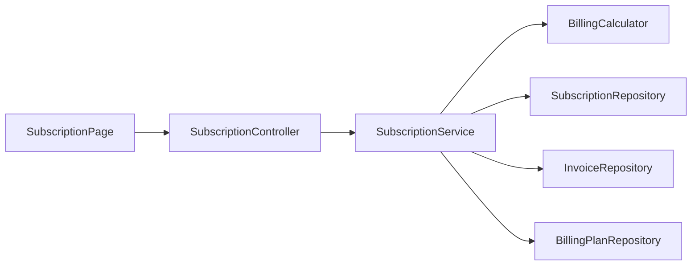
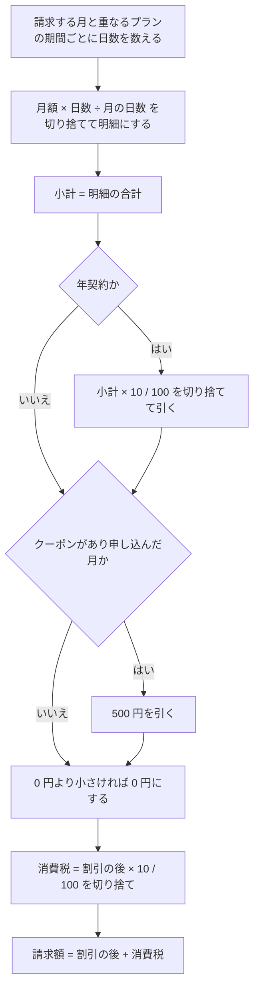

# Design Document

## Overview

**Purpose**: 法人向けの文房具の定期便の契約を持ち、月ごとの請求書を決まった計算の順序で作る。
**Users**: お客様が定期便を申し込み、プランを変え、解約する。店の担当者が月ごとに請求書を作る。
**Impact**: EC と同じプロジェクトに、プラン・契約・プランの期間・請求書・請求書の明細の 5 つのテーブルを足す。

### Goals
- 請求額の計算を BillingCalculator の 1 か所に集め、requirements.md の「請求額の求め方」の 1〜4 をこの順に書く
- 受入基準の請求額と 1 円の違いもなく一致させる
- 同じ月の請求書を、データベースの一意制約で 1 通に限る

### Non-Goals
- 支払い、届ける文房具の中身・配送、担当者の権限

## Boundary Commitments

### This Spec Owns
- プラン・契約・プランの期間・請求書・請求書の明細のテーブル
- 請求額の計算（日割り・割引・消費税・端数）
- 定期便の申し込み・プランの変更・解約・請求書の作成の API

### Out of Boundary
- 顧客の認証（EC の既存のログインをそのまま使う）
- EC・講座の予約・購買申請（それぞれ別の spec）

### Allowed Dependencies
- 既存の customer テーブル（お客様は ID だけで扱い、EC のクラスは参照しない）

## Architecture

### Architecture Pattern & Boundary Map



- 請求額の計算は BillingCalculator、契約の操作と請求書の作成は SubscriptionService に置く。BillingCalculator はデータベースに触らない
- パッケージは `com.example.ecsite.billing` に分け、ほかの業務のクラスを参照しない（steering の structure.md に従う）

### Technology Stack

| Layer | Choice / Version | Role in Feature | Notes |
|-------|------------------|-----------------|-------|
| Frontend | React 19 | 申し込み・プランの変更・解約・請求書の画面 | |
| Backend | Spring Boot 4.1（Web MVC・Data JPA） | API と請求額の計算 | 追加のライブラリはない |
| Data | PostgreSQL 18・Flyway | 契約と請求書 | V4 でテーブルとプラン 2 件を作る |

## File Structure Plan

```
backend/src/main/java/com/example/ecsite/billing/
├── controller/   # SubscriptionController
├── service/      # SubscriptionService, BillingCalculator
├── repository/   # BillingPlanRepository, SubscriptionRepository, InvoiceRepository
├── entity/       # BillingPlan, Subscription, PlanPeriod, Invoice, InvoiceLine
├── dto/
└── exception/    # BillingException, BillingError
backend/src/main/resources/db/migration/V4__create_billing_tables.sql
backend/src/main/resources/db/sample/R__sample_subscriptions.sql
frontend/src/pages/SubscriptionPage.tsx   # 定期便の申し込み・プラン変更・解約・請求書
```

## System Flows



## Requirements Traceability

| Requirement | Summary | Components | Interfaces |
|-------------|---------|------------|------------|
| 1.1 | 1 か月分の請求書 | BillingCalculator, SubscriptionService | POST /api/subscriptions/{id}/invoices |
| 2.1-2.3 | 申し込んだ月の日割り | BillingCalculator | POST /api/subscriptions/{id}/invoices |
| 3.1-3.3 | プランを変えた月の日割り | SubscriptionService, BillingCalculator | POST /api/subscriptions/{id}/change-plan |
| 4.1-4.4 | 年契約の割引とクーポンの順序 | BillingCalculator | POST /api/subscriptions/{id}/invoices |
| 5.1-5.2 | 解約した月の日割りと翌月の拒否 | SubscriptionService, BillingCalculator | POST /api/subscriptions/{id}/cancel |
| 6.1-6.2 | 同じ月の請求書を 1 通に限る | SubscriptionService, InvoiceRepository | POST /api/subscriptions/{id}/invoices |

## Components and Interfaces

| Component | Layer | Intent | Req Coverage |
|-----------|-------|--------|--------------|
| BillingCalculator | service | プランの期間と請求する月から、明細と各金額を求める | 1, 2, 3, 4, 5 |
| SubscriptionService | service | 申し込み・プランの変更・解約・請求書の作成 | 3, 5, 6 |
| InvoiceRepository | repository | 請求書を保存する（一意制約で 1 通に限る） | 6 |

### API Contract

エラーの応答は EC と同じ `{ "code": "ALREADY_ISSUED", "message": "その月の請求書はすでに作りました" }` の形にする。

| Method | Endpoint | Request | Response | Errors |
|--------|----------|---------|----------|--------|
| GET | /api/billing-plans | - | プランの一覧（code・name・monthlyFee） | - |
| POST | /api/subscriptions | `{ customerId, planCode, startedOn, annual, coupon }` | 201 契約 | 404 PLAN_NOT_FOUND |
| GET | /api/subscriptions?customerId= | - | お客様の契約の一覧（プランの期間を含む） | - |
| POST | /api/subscriptions/{id}/change-plan | `{ planCode, effectiveOn }` | 契約 | 400 INVALID_DATE, 404 PLAN_NOT_FOUND, 409 SAME_PLAN |
| POST | /api/subscriptions/{id}/cancel | `{ cancelledOn }` | 契約 | 400 INVALID_DATE |
| POST | /api/subscriptions/{id}/invoices | `{ billingMonth }` | 201 請求書 | 409 NOT_SUBSCRIBED_IN_MONTH, 409 ALREADY_ISSUED |
| GET | /api/subscriptions/{id}/invoices | - | 作った請求書の一覧 | - |

請求書の応答の例:

```json
{ "billingMonth": "2026-10", "lines": [{ "planCode": "LIGHT", "fromDate": "2026-10-01", "toDate": "2026-10-15", "days": 15, "amount": 1451 }],
  "subtotal": 4031, "annualDiscount": 0, "couponDiscount": 0, "afterDiscount": 4031, "tax": 403, "total": 4434 }
```

### State Management
- プランの期間を始まりの日と終わりの日で持つ。プランを変えると、今の期間の終わりの日を変更日の前日にし、変更日から始まる新しい期間を足す。解約すると、今の期間の終わりの日を解約日にする
- 同じ月の請求書は、一意制約 `(subscription_id, billing_month)` で 1 通に限る。作る前に同じ月の請求書を探し、あれば ALREADY_ISSUED にする。同時に作られて一意制約に違反したときも ALREADY_ISSUED にする

## Data Models

### Physical Data Model

**billing_plans**

| 列 | 型 | 制約 |
|---|---|---|
| code | varchar(20) | PK。LIGHT / STANDARD |
| name | varchar(50) | NOT NULL |
| monthly_fee | bigint | NOT NULL, CHECK (monthly_fee >= 0)。税抜きの月額 |

V4 で、ライト（3,000 円）とスタンダード（5,000 円）を入れる。

**subscriptions**

| 列 | 型 | 制約 |
|---|---|---|
| id | bigserial | PK |
| customer_id | bigint | NOT NULL, FK → customer(id) |
| started_on | date | NOT NULL。申し込んだ日 |
| annual | boolean | NOT NULL。年契約か |
| coupon | boolean | NOT NULL。クーポンを使ったか |
| cancelled_on | date | 解約した日。この日まで使える |

**plan_periods**

| 列 | 型 | 制約 |
|---|---|---|
| id | bigserial | PK |
| subscription_id | bigint | NOT NULL, FK → subscriptions(id) ON DELETE CASCADE |
| plan_code | varchar(20) | NOT NULL, FK → billing_plans(code) |
| starts_on | date | NOT NULL |
| ends_on | date | NULL なら続いている。CHECK (ends_on IS NULL OR starts_on <= ends_on) |

**invoices**

| 列 | 型 | 制約 |
|---|---|---|
| id | bigserial | PK |
| subscription_id | bigint | NOT NULL, FK → subscriptions(id) |
| billing_month | varchar(7) | NOT NULL。例: 2026-10 |
| subtotal | bigint | NOT NULL。小計 |
| annual_discount | bigint | NOT NULL。年契約の割引 |
| coupon_discount | bigint | NOT NULL。クーポンで実際に引いた額 |
| after_discount | bigint | NOT NULL, CHECK (after_discount >= 0) |
| tax | bigint | NOT NULL |
| total | bigint | NOT NULL |
| issued_at | timestamptz | NOT NULL |
| | | UNIQUE (subscription_id, billing_month) |

**invoice_lines**

| 列 | 型 | 制約 |
|---|---|---|
| id | bigserial | PK |
| invoice_id | bigint | NOT NULL, FK → invoices(id) ON DELETE CASCADE |
| plan_code | varchar(20) | NOT NULL |
| from_date | date | NOT NULL |
| to_date | date | NOT NULL |
| days | integer | NOT NULL |
| amount | bigint | NOT NULL。日割りの金額 |

## Error Handling

| 理由コード | HTTP ステータス | 意味 |
|---|---|---|
| SUBSCRIPTION_NOT_FOUND | 404 | 契約がない |
| PLAN_NOT_FOUND | 404 | プランがない |
| INVALID_DATE | 400 | 日付が正しくない（変更日や解約日が契約の期間の外など） |
| SAME_PLAN | 409 | 同じプランには変えられない |
| NOT_SUBSCRIBED_IN_MONTH | 409 | その月は契約していない |
| ALREADY_ISSUED | 409 | その月の請求書はすでに作った |

BillingException に理由コードを持たせ、ApiExceptionHandler で HTTP の応答に変える。

## Testing Strategy

- 受入基準ごとにテストを作る（steering の testing.md）。テストのメソッド名は `要件2_1_...` のように受入基準の番号で始める
- 金額は long の円で扱い、端数と割引・税の順序は requirements.md の「請求額の求め方」に書かれたとおりにする。日付は LocalDate で扱う
- 6.2 は、2 スレッドから同時に請求書を作るテストで確かめる
