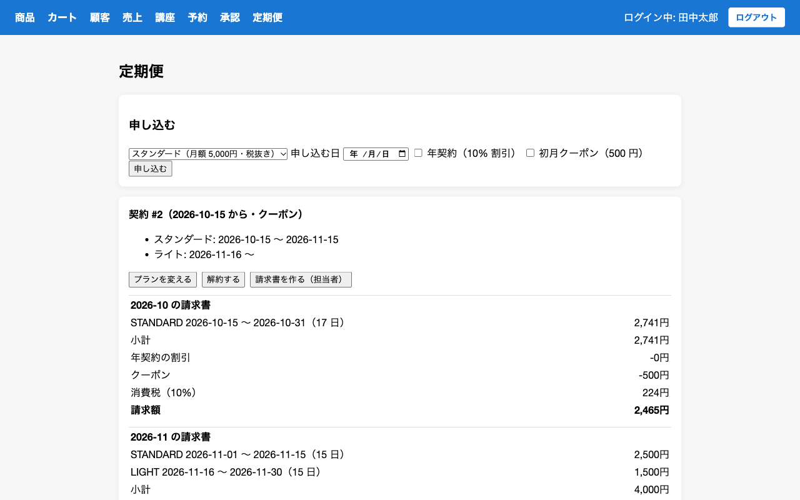
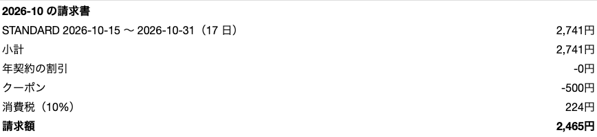
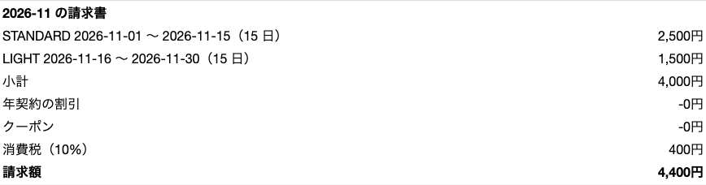
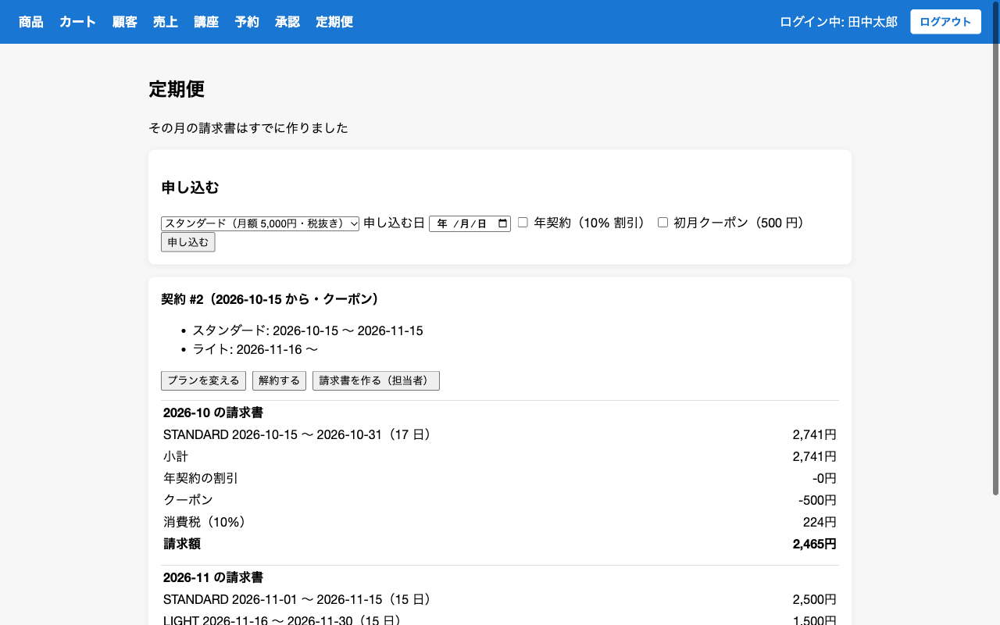

# Quickstart: 文房具の定期便の月額課金

## テストを実行する

```bash
cd backend
./mvnw test
```

## 画面で確かめる

1. tanaka@example.com / 123 でログインし、「定期便」を開く
2. 申し込んだ日を月の途中にしてスタンダードを申し込み、その月の請求書を作る。日割りの金額が表示されることを確かめる
3. 翌月の途中からライトに変え、翌月の請求書を作る。2 つの期間の明細が表示されることを確かめる
4. 同じ月の請求書をもう一度作り、「すでに作った」と表示されることを確かめる

## 画面

定期便の画面。申し込み、プランの期間（プランを変えると期間が区切られる）、請求書が並ぶ



10 月 15 日に申し込んだ月の請求書。17 日分の日割り（切り捨て）からクーポン 500 円を引き、消費税 10% をかける



11 月 16 日にライトへ変えた月の請求書。変更の前と後で分けて日割りにする



同じ月の請求書をもう一度作ろうとすると、「すでに作りました」と表示されて作られない


